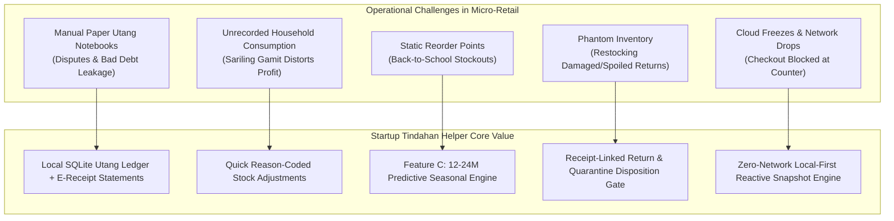
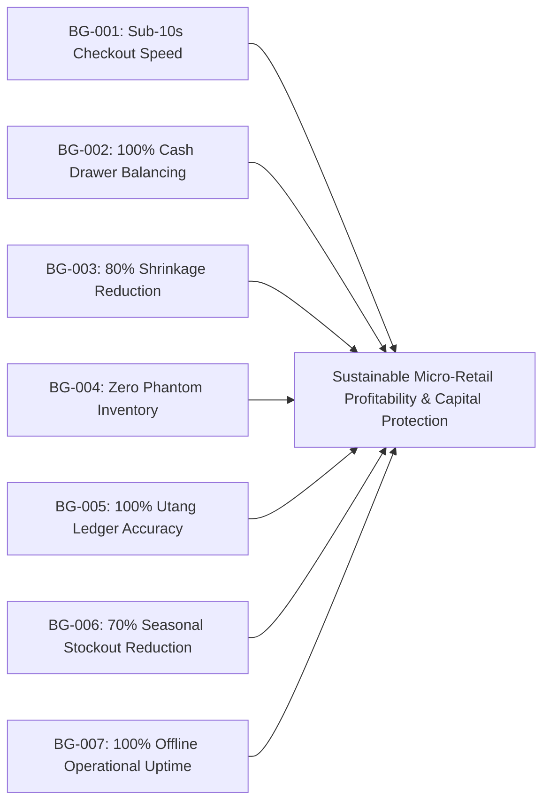

# Business Requirements Document (BRD) & Stakeholder Needs Elicitation

> **Project**: Startup Tindahan Helper (*Juan's Store POS & Inventory System*)  
> **Standard Compliance**: ISO/IEC/IEEE 29148:2018 (Requirements Engineering) & ISO/IEC 25010 (Software Product Quality)  
> **Target Platform**: Single-Device Mobile (Android 10+, iOS 15+) via Expo SDK 57 & React Native 0.86  
> **Operational Domain**: Philippine Micro-Retail (*Sari-Sari Store* / Neighborhood Convenience)  
> **Companion Documents**:
> - [FUNCTIONAL_REQUIREMENTS.md](file:///c:/Developer/startupTindahanHelper/FUNCTIONAL_REQUIREMENTS.md)
> - [NON_FUNCTIONAL_REQUIREMENTS.md](file:///c:/Developer/startupTindahanHelper/NON_FUNCTIONAL_REQUIREMENTS.md)
> - [POS_PROBLEMS_AND_SEASONAL_FORECAST.md](file:///c:/Developer/startupTindahanHelper/POS_PROBLEMS_AND_SEASONAL_FORECAST.md)
> - [DATA_INPUT_OUTPUT_UX_BEST_PRACTICES.md](file:///c:/Developer/startupTindahanHelper/DATA_INPUT_OUTPUT_UX_BEST_PRACTICES.md)
> - [REACT_EXPO_OOP_BEST_PRACTICES.md](file:///c:/Developer/startupTindahanHelper/REACT_EXPO_OOP_BEST_PRACTICES.md)

---

## 1. Project Vision & Executive Summary

### 1.1 Context & Problem Statement
In the Philippines, there are over **1.3 million *sari-sari* stores** (*tindahan*), accounting for over **60% of fast-moving consumer goods (FMCG) distribution**. Despite being the primary retail backbone of neighborhood communities, the vast majority operate entirely on manual, paper-based workflows:
1. **Paper *Cuaderno* Utang Ledgers**: Neighborhood credit (*utang*) is recorded in battered spiral notebooks. Entries are easily forgotten, illegible, or disputed, leading to **15%–25% debt leakage** and damaged community trust.
2. **Invisible Shrinkage & Unrecorded Household Use (*Sariling Gamit*)**: Store owners and their families draw groceries, soap, and cooking oil directly from store shelves for personal consumption without recording cost deductions, distorting real gross margins and tax/net profit figures.
3. **Chronic Stockouts & Capital Lockup in Seasonal Transitions**: High-volume seasonal spikes—such as **School Opening (July/August)**, local barangay fiestas, and **Christmas (*Noche Buena*)**—catch store owners unprepared. Due to static mental reorder points, owners suffer severe lost sales during peak weeks while locking limited working capital in slow-moving items during ordinary months.
4. **Phantom Inventory & Return Fraud**: When customers bring back defective, spoiled, or wrong items, manual record-keeping either fails to tie returns to original sales or blindly restocks damaged goods back into sellable inventory, creating "phantom inventory" and corrupted supply calculations.
5. **Fragile Cloud Dependency in Connectivity Deserts**: Existing enterprise POS applications fail because they depend on 24/7 cloud connectivity. Inside concrete barangay homes or during frequent cellular network brownouts, cloud apps freeze, blocking transactions when customer queues form at the store window.

### 1.2 Proposed Solution Vision
**Startup Tindahan Helper (*Juan's Store POS*)** is an offline-first, single-device mobile Point-of-Sale and Inventory Management application engineered explicitly for Filipino store owners. Built on **Expo SDK 57**, **React Native 0.86**, and **embedded SQLite (`expo-sqlite`)**, it operates with **100% offline autonomy**, zero monthly subscription fees, and high-performance thumb-driven ergonomics.

The system combines:
- Fast barcode checkout (camera scan and manual keypad entry with GS1 checksum validation).
- Single-source catalog hierarchy supporting fractional *tingi* conversions (piece vs. pack vs. case).
- Integrated *Utang* credit management with split-tender reconciliation and digital e-receipt generation.
- Owner-centric exception gating (voids, returns, exchanges, and quarantine for bad orders).
- **Feature C: Seasonal Product Forecast Engine**, utilizing historical multi-year same-month predictive analytics with stockout demand-uncensoring and anomaly filtering.

---

## 2. Stakeholder Needs Elicitation & Analysis

### 2.1 Elicitation Methodology
Stakeholder requirements were elicited through a combined methodology:
1. **Vertical Domain Research (AnySearch)**: Systematic elicitation of Philippine retail studies, micro-retail POS surveys, and academic literature on sari-sari store supply chains.
2. **Operational Prototype Audit**: In-depth analysis of the 7-screen *Juan's Store POS* design prototype (`Gemini_Generated_Image_tx51cztx51cztx51.jpg`), identifying workflow touchpoints, ergonomics, and edge cases.
3. **Retail Industry Best Practices**: Synthesized from ISO/IEC/IEEE 29148 standards, Oracle Retail Xstore POS, and Microsoft Dynamics 365 POS exception handling frameworks.

### 2.2 Stakeholder Profiles & Personas

| Stakeholder Persona | Role in Ecosystem | Primary Responsibilities | Core Pain Points & Friction | Critical System Expectations |
| :--- | :--- | :--- | :--- | :--- |
| **Juan / Maria (Store Owner)** | Sole Proprietor & Primary Operator | Purchasing stock from wholesalers, setting prices, ringing up sales, managing cash, extending credit, settling debts. | High operational multitasking; outdoor glare; wet/dusty hands; mental math errors on odd cash change; forgotten household withdrawals. | Sub-second barcode lookup; 1-tap stock adjustments; foolproof change calculator; actionable restock shopping list for wholesale trips. |
| **Ate Joy (Relief Family Helper)** | Part-time Cashier / Substitute | Mind the store window during lunch hours or when owner is at wholesale market. | Unfamiliar with unbarcoded items or custom prices; prone to double-tapping checkout; fear of breaking data. | Guided, idiot-proof workflows; scan-to-create shortcuts; automatic duplicate check; prominent stock badges; immediate error haptics. |
| **Mang Bert (Neighborhood Customer - 'Suki')** | Loyal Customer with Credit Line | Purchases daily food essentials, household goods; frequently buys on credit (*utang*) until payday. | Disputes over illegible pencil marks in paper notebook; forgotten partial payments; lack of proof of balance. | Itemized digital proof of debt; immediate balance update; ability to pay in partial installments without dispute. |
| **Walk-in Retail Customer** | Cash / E-Wallet Shopper | Buys cold refreshments, single-serve snacks (*tingi*); pays with mixed cash/coins or GCash. | Long checkout queues; lack of loose change (*barya*); slow manual receipt writing. | Transaction under 10 seconds; acceptance of exact bill/coin combinations; GCash transaction reference capture. |
| **Divisoria / Megamart Wholesaler** | External Stock Supplier | Sells goods in cases/boxes/bundles; delivers bulk restock. | Store owner orders haphazardly or runs out of cash mid-purchase due to poor seasonal foresight. | Clear, consolidated shopping lists with case-to-piece conversions and estimated capital requirements. |
| **Barangay / Local Tax Authority** | Regulatory Body | Monitors neighborhood micro-businesses (BMBE Law - RA 9178). | Inaccurate sales records for micro-enterprise compliance. | Clear Gross vs. Net sales breakdown with excluded voids and returned items. |

### 2.3 Comprehensive Stakeholder Needs Matrix

| Stakeholder Need ID | Stakeholder | Elicited Need Description | Root Cause / Operational Context | Traceable Business Goal |
| :--- | :--- | :--- | :--- | :--- |
| **SN-001** | Store Owner | Must ring up sales in $<10$ seconds even when packaging is crumpled, wet, or unbarcoded. | Foil snack packs (*Piattos*) wrinkle; chilled drink bottles (*C2*) sweat; repacked sugar has no barcode. | **BG-001** (Fast Checkout) |
| **SN-002** | Store Owner | Must calculate exact change when customers hand non-standard cash/coins (e.g., ₱64 for a ₱54 bill). | Customers provide odd coins to receive round bills/coins and conserve *barya*. Fixed cash buttons alone fail. | **BG-002** (Cash Integrity) |
| **SN-003** | Store Owner | Must record *sariling gamit* (personal household consumption) at cost in 2 taps. | Taking goods for home cooking without tracking drains working capital and hides real store profitability. | **BG-003** (Shrinkage Control) |
| **SN-004** | Owner & Cashier | Must process customer returns and exchanges without accidentally restocking spoiled/expired items. | Defective items returned to shelves create "phantom inventory," disappointing subsequent customers. | **BG-004** (Inventory Accuracy) |
| **SN-005** | Suki Customer | Must receive a verifiable digital receipt or ledger statement of total debt balance on Messenger/SMS. | Traditional paper notebooks lack transparency, causing relational friction when balances are collected. | **BG-005** (Utang Transparency) |
| **SN-006** | Store Owner | Must know exactly how much school supplies or holiday goods to pre-order 2–3 weeks before seasonal peaks. | Relying on ordinary month averages causes stockouts within 48 hours of School Opening in July. | **BG-006** (Seasonal Forecasting) |
| **SN-007** | Store Owner | Must operate seamlessly without electricity or cellular internet during typhoons or rural blackouts. | Grid failures are frequent in provincial municipalities (e.g., Nueva Ecija). Cloud POS apps become useless. | **BG-007** (Offline Autonomy) |

---

## 3. Business Goals, Objectives & Key Performance Indicators (KPIs)

### 3.1 Quantified Business Goals (BG)

| Goal ID | Strategic Business Objective | Baseline (Manual/Paper POS) | Target KPI with Juan's Store POS | Measurement Protocol |
| :--- | :--- | :--- | :--- | :--- |
| **BG-001** | Accelerate Counter Checkout Throughput | 35–60 seconds per customer basket | **$\le 10$ seconds** for a 3-item basket | Time-motion study from first scan to cash settlement. |
| **BG-002** | Eliminate Cash Tender & Change Errors | 3–5 calculation errors per 100 cash sales | **0 calculation errors** ($100\%$ precision) | Daily cash drawer reconciliation vs. SQLite expected total. |
| **BG-003** | Capture Unrecorded Household Shrinkage | ₱1,500–₱3,500/month unrecorded leakage | **$\le$ ₱100/month** unaccounted variance | Monthly inventory audit variance logged in SQLite ledger. |
| **BG-004** | Prevent Phantom Stock from Damaged Returns | 100% of returns manually dumped onto shelf | **0% defective items restocked** | Audit of quarantine bucket vs. active inventory count. |
| **BG-005** | Resolve Debt Disputes & Accelerate Utang Collection | 15%–25% disputed or defaulted debt | **$< 2\%$ default rate**; 0 unverified claims | Debt collection cycle time and ledger audit reconciliation. |
| **BG-006** | Eliminate Peak Season Stockouts & Capital Waste | 65% stockout rate during School Opening week | **$\le 15\%$ stockout rate** during seasonal peaks | Stock availability log for high-season SKUs across July–Aug. |
| **BG-007** | Guarantee Zero-Downtime Autonomous Availability | 100% failure rate during internet outages | **100% offline availability** (zero dropped sales) | Synthetic cellular disconnect testing under continuous POS load. |

---

## 4. Business Scope & Boundaries

### 4.1 In-Scope Capabilities
- **Local Embedded Point-of-Sale**: Dual-mode camera and manual barcode entry, quick product grid, cart stepper, itemized discounts, multi-tender settlement.
- **Tender Options**: Cash (with dynamic change calculation), GCash/Maya reference recording, Customer *Utang* ledger, and hybrid split payments (Cash + *Utang* balance).
- **Single-Source Inventory & Catalog**: Base unit tracking, fractional *tingi* conversions (piece/pack/case), reason-coded stock adjustments (Restock, Household Consumption, Damaged/B.O., Audit).
- **Exception Handling Workflows**: Same-day receipt voids, receipt-linked returns with mandatory disposition gating (Sellable Restock vs. Bad Order Quarantine), and atomic in-flow product exchanges.
- **Neighborhood Credit (*Utang*) Management**: Customer directory, individual credit limits, partial debt repayment tracking, and 1-tap shareable e-receipt image statements.
- **Feature C: Seasonal Demand Forecast Engine**: Multi-tier algorithms (12M initial vs. 24M+ multi-year recurring YoY), demand uncensoring for stockout days, void/anomaly exclusion, and plain-language restock shopping list export.
- **Store Preferences & Offline Backup**: Store branding, school opening calendar configuration, language selection (English/Filipino), and SQLite database export/import.

### 4.2 Out-of-Scope Capabilities
- Multi-branch cloud ERP enterprise synchronization.
- Direct credit card EMV chip-and-pin hardware terminal integration.
- Direct banking API / automated GCash merchant webhook settlement (relies on manual 4-digit reference logging).
- Automated BIR CAS (Computerized Accounting System) server transmission (designed for micro-enterprises under the BMBE Act).
- Hardware mechanical scale integration (weight inputs are entered manually via numeric keypad).

---

## 5. Core Business Rules (BR)

### BR-RUL-001: Single-Source Base Unit & Fractional Pricing
All product quantities in inventory MUST be stored in a single fundamental **Base Unit** (e.g., 1 piece / 1 sachet).
- Selling multi-packs or cases MUST deduct the exact multiplier from the base inventory pool (e.g., 1 pack of 6 deducts 6 base units).
- Product pricing MUST support bundle tiers (e.g., 1 piece = ₱16.00, bundle of 2 = ₱24.00) without creating disconnected SKU records.
- All monetary amounts MUST be computed and stored as integer centavos to eliminate floating-point penny drift.

### BR-RUL-002: Zero-Tolerance Phantom Inventory & Disposition Gating
No returned product may enter the active sellable stock without passing through a mandatory **Disposition Assessment**:
- If an item is flagged `Damaged`, `Expired`, `Defective`, or `Bad Order (B.O.)`, it MUST be routed directly to the `Quarantine Stock Bucket`. It MUST NOT increment the sellable stock count.
- Only items verified in `Sellable Condition` (e.g., customer changed mind, unopened package) may increment the sellable stock count.
- All return refunds MUST be tied to the verified historical purchase price on the original receipt.

### BR-RUL-003: Utang Credit Limit & Demand Event Imputation
- Transactions charged to *Utang* MUST immediately deduct physical inventory and record a sales demand event on the current date, regardless of when cash is settled.
- A sale cannot be charged to *Utang* if the resulting balance exceeds the customer's configured `Credit Limit` unless explicitly overridden by the Store Owner.
- Cash received for *Utang* repayment MUST be recorded as a debt balance reduction and cash drawer inflow, NOT as a duplicate merchandise sale.

### BR-RUL-004: Payment Settlement Integrity & Underpayment Guard
- For `Cash` and `GCash` sales, the entered `Amount Received` MUST be greater than or equal to `Total Due`.
- If `Amount Received < Total Due`, the POS MUST block completion unless the deficit is explicitly converted to an *Utang* charge against a registered customer.
- Change Due MUST be calculated automatically using exact integer centavos arithmetic.

### BR-RUL-005: Idempotency & Single-Device Concurrency Lock
- Tapping `Complete Sale`, `Save Product`, or `Process Return` MUST acquire a synchronous execution lock immediately ($< 1\text{ ms}$) to prevent double-tap race conditions.
- Every sale record MUST have a client-generated UUID v4 idempotency token.

### BR-RUL-006: Seasonal Demand Uncensoring & Anomaly Protection
- Historical sales data used in **Feature C (Seasonal Product Forecast)** MUST impute unrecorded demand for days when stock was zero (`Stock = 0`), scaling net sales by total days over in-stock days.
- Transactions marked `VOIDED` or items returned due to entry errors MUST be excluded from historical demand models.
- One-time non-recurring bulk orders (e.g., barangay fiesta catering) flagged by the owner MUST be isolated to prevent artificial inflation of ordinary recurring forecasts.

---

## 6. Financial, Operational & Environmental Risk Assessment

| Risk Description | Severity | Probability | Operational Impact | Mitigation Strategy |
| :--- | :--- | :--- | :--- | :--- |
| **Physical Cash Drawer Discrepancy** | High | Medium | Store owner loses daily profit due to miscounting or short change. | Mandatory `Amount Received` numeric input with automatic Change Due display and quick bill helper chips. |
| **Customer Credit Default (Bad Debts)** | High | High | Working capital becomes trapped in unpaid balances, halting restocking. | Enforced credit limits in SQLite, timestamped transaction history, and 1-tap shareable statement image exports. |
| **Hardware Drop, Loss or Water Damage** | Critical | Low | Complete loss of historical sales, inventory records, and credit ledger. | 1-tap SQLite database backup export to phone storage, SD card, or Google Drive share sheet. |
| **Device Overheating in Tropical Glare** | Medium | High | Camera viewfinder causes thermal throttling on low-cost phones under $35^\circ\text{C}$ heat. | Auto-sleep timer on camera viewfinder after 45 seconds of inactivity; high-contrast UI meeting WCAG AA under outdoor sunlight. |
| **Seasonal Overstocking / Spoilage** | High | Medium | Purchasing perishable seasonal goods that do not sell leads to total inventory write-off. | 3-tier confidence indicators (`PROVISIONAL`, `INITIAL`, `VERIFIED`) and wholesale capital budget capping. |

---

## 7. Business Requirements Approval & Sign-Off Criteria

1. **Completeness**: All 7 prototype screens (`POS/Scan`, `Product List`, `Checkout`, `Inventory`, `Sales History`, `Menu`, `Settings`) and supporting domain workflows have full business coverage.
2. **Consistency**: Traceable 1:1 mapping between Stakeholder Needs, Business Goals, Functional Requirements, and Non-Functional Requirements.
3. **Feasibility**: Strictly implementable on Expo SDK 57, React Native 0.86, and SQLite on entry-level Android devices without recurring server dependencies.
4. **Verifiability**: Every business rule and goal is mapped to measurable, binary acceptance criteria in the companion specification files.
