# Data Input, Data Output & Mobile POS UX Best Practices (React Native + Expo)

> **Project**: Startup Tindahan Helper (*Juan's Store POS & Inventory System*)  
> **Research Engine**: AnySearch (`expo` official guides on Keyboard Handling, Local-First SQLite, `expo-camera`, `expo-sharing`, `expo-haptics`, and Retail POS Touch Ergonomics)  
> **Companion Docs**: [POS_PROBLEMS_AND_SEASONAL_FORECAST.md](file:///c:/Developer/startupTindahanHelper/POS_PROBLEMS_AND_SEASONAL_FORECAST.md) · [REACT_EXPO_OOP_BEST_PRACTICES.md](file:///c:/Developer/startupTindahanHelper/REACT_EXPO_OOP_BEST_PRACTICES.md) · **UI Prototype**: [Gemini_Generated_Image_tx51cztx51cztx51.jpg](file:///c:/Developer/startupTindahanHelper/ui/Gemini_Generated_Image_tx51cztx51cztx51.jpg)

---

## Executive Summary

In a neighborhood *sari-sari* store (*tindahan*), the POS app is operated in a high-distraction environment: customers waiting at the window, bright outdoor glare, wet or dusty hands from handling cold bottled drinks and snacks, and intermittent barangay internet.

To make **Juan's Store POS** fast, error-proof, and intuitive, the system must follow strict **Data Input**, **Data Output**, and **Mobile UX** engineering standards across all 7 screens of the prototype:

```mermaid
flowchart LR
    subgraph INPUT["1. Data Input Best Practices"]
        I1["Dual Barcode Entry\n(Scan OR Manual Input + Checksum)"]
        I2["Zero-Keyboard Checkout\n(Quick Cash Pills & + / - Steppers)"]
        I3["KeyboardAwareScrollView\n(No 'Keyboard Bounce of Death')"]
        I4["Idempotent Submit Lock\n(Prevents Double-Tap Duplicate Sales)"]
    end

    subgraph UX["2. Mobile POS UX & Ergonomics"]
        U1["48x48dp Touch Targets\n+ Thumb-Zone Primary CTAs"]
        U2["Multi-Sensory Feedback\n(expo-haptics + Scan Beep/Buzz)"]
        U3["Forgiving Workflows\n(Hold Cart, Undo Toast, Void Guard)"]
    end

    subgraph OUTPUT["3. Data Output Best Practices"]
        O1["Tabular PHP (₱) Formatting\n& Integer Centavo Precision"]
        O2["Triple-Encoded Badges\n(Color + Icon + Text for Glare)"]
        O3["Action-First Seasonal Forecast\n(Peak vs Ordinary Month Cards)"]
        O4["1-Tap E-Receipt & Thermal Print\n(ViewShot + expo-sharing)"]
    end

    INPUT --> UX --> OUTPUT
```



---

## Part 1: Data Input Best Practices (Capturing Clean Data Fast)

### 1.1 Dual-Mode Product Barcode Registration (`Manual Input` OR `Camera Scan`)
When adding a product via **Screen 4 (`Inventory Management` $\rightarrow$ `+` button)** or via **Screen 1 (`Scan-to-Create`)**:
- **Never force camera-only or keyboard-only entry**:
  - **Camera Scan Mode**: Best for flat, clean packaging. Uses `CameraView` (`expo-camera`) with `onBarcodeScanned` locked immediately on the first valid frame.
  - **Manual Keypad Input Mode**: Essential when a snack wrapper (*Piattos*, *Pancit Canton*) is crumpled or a cold bottle (*C2*, *Sprite*) is covered in condensation.
  - **Last-4-Digits Quick Lookup**: During checkout (Screen 1) or return lookup (Screen 5), allow typing the **last 4 digits** of a barcode (e.g., `0709` for `6800056520709`) to surface the matching SKU immediately.
  - **Auto-Generated Shortcode for Unbarcoded *Tingi***: Provide a 1-tap `Generate Store Code` button (`TINGI-0001`, `#01`) for ice, repacked sugar, or single pieces of school supplies.

### 1.2 Match Every `TextInput` to the Exact Hardware Keyboard Type
Opening a full QWERTY keyboard when the user only needs to enter a price or stock count wastes 40% of the screen and doubles typo rates. Enforce strict input props across every form:

| Input Field | Prototype Screen | `keyboardType` | Additional React Native Props | Validation Rule |
| :--- | :--- | :--- | :--- | :--- |
| **Barcode Input** | Screen 4 (`+ Add Product`), Screen 1 | `default` (or `number-pad` toggle) | `autoCapitalize="characters"`, `autoCorrect={false}`, `returnKeyType="next"` | 8/12/13-digit GS1 Modulo-10 check digit OR `[A-Z0-9#-]{2,20}` custom code; instant duplicate SKU check. |
| **Product Name** | Screen 4 (`+ Add Product`) | `default` | `autoCapitalize="words"`, `returnKeyType="next"`, `maxLength={80}` | Non-empty trimmed string; warns if fuzzy-similar name already exists. |
| **Selling Price / Unit Cost (₱)** | Screen 4 (`+ Add Product`), Screen 3 (`Discount`) | `decimal-pad` | `selectTextOnFocus={true}`, `placeholder="0.00"` | Positive number $\le \text{₱99,999.99}$; converted immediately to integer centavos (`₱16.00` $\rightarrow$ `1600`). |
| **Stock Quantity / Restock Count** | Screen 4 (`Inventory`), Screen 3 (`Cart`) | `number-pad` | `selectTextOnFocus={true}`, `maxLength={6}` | Non-negative integer (or positive decimal only if unit is `kg`/`liter`). |
| **Search Bar** | Screens 1, 2, 4 | `web-search` | `clearButtonMode="while-editing"`, `autoCorrect={false}` | 150ms debounced local SQLite `LIKE` / FTS query. |

### 1.3 Eliminate Keyboard Occlusion ("Keyboard Bounce of Death")
As highlighted in the official **Expo Keyboard Handling Guide**, standard `KeyboardAvoidingView` often miscalculates offsets on Android modals with multiple inputs.
- **Best Practice**: Wrap multi-field forms (`Add Product`, `Return/Exchange Wizard`, `Store Settings` in Screen 7) in `KeyboardAwareScrollView` and `KeyboardToolbar` from `react-native-keyboard-controller`:
  - Automatically scrolls the active input above the keyboard.
  - Provides `Previous` / `Next` field focus arrows and a `Done` dismiss button above the numeric keypad (crucial on iOS where `number-pad` lacks a native `Return` key).

### 1.4 Hybrid User-Input Payment Tender (`TextInput`) + Quick-Fill Denomination Chips at Checkout (`Screen 3`)
Why did a "quick-tap buttons only" approach fail in **Screen 3 (`New Sale`)**?
- **Root Cause Found via AnySearch**: In real retail and *sari-sari* store checkouts, customers frequently hand **non-standard bill + coin combinations** (e.g., paying `₱64.00` for a `₱54.00` total so the owner can return a single `₱10.00` coin instead of running out of `₱1` coins). If Screen 3 only provides fixed banknote buttons (`₱60`, `₱100`, `₱200`, `₱500`) without a **manual `TextInput` for `Payment Amount Received (₱)` and `Discount (₱)`**, the owner cannot enter custom tendered amounts, and tapping `Complete Sale` without validating `Amount Tendered >= Total Due` risks underpayment or change-calculation errors.
- **Best Practice**:
  - Render an explicit **`Amount Received (₱)` `TextInput`** (`keyboardType="decimal-pad"`, `selectTextOnFocus={true}`) where the owner types the exact payment received, plus a **`Discount (₱)` `TextInput`**.
  - Pair the `TextInput` with 1-tap quick-fill chips (`[ Exact ₱54 ]`, `[ ₱60 ]`, `[ ₱100 ]`, `[ ₱200 ]`, `[ ₱500 ]`, `[ ₱1,000 ]`) that populate the `TextInput` value.
  - Enforce a strict **Underpayment Guard**: If `Amount Received < Total Due` on a Cash sale, highlight the deficit (`Short by ₱XX.XX`), disable `Complete Sale` until sufficient payment is entered, or offer a 1-tap **`Charge Remaining ₱XX.XX to Utang`** split-settlement option.

### 1.5 Idempotent Submission & Double-Tap Prevention
In busy retail environments, users frequently double-tap `Complete Sale` (Screen 3) or `Save Product` (Screen 4).
- **Best Practice**:
  1. Generate a client-side `idempotencyKey` (UUID v4) as soon as a draft cart or return is opened.
  2. Lock the submit button synchronously via a `useRef<boolean>(false)` guard (`isSubmittingRef.current = true`) on the very first press—before React's asynchronous `useState` re-render cycle completes.

```tsx
// src/presentation/hooks/useIdempotentSubmit.ts
import { useRef, useState, useCallback } from 'react';

export function useIdempotentSubmit<TArgs extends unknown[], TResult>(
  action: (...args: TArgs) => Promise<TResult>
) {
  const lockRef = useRef(false);
  const [isSubmitting, setIsSubmitting] = useState(false);

  const trigger = useCallback(
    async (...args: TArgs): Promise<TResult | undefined> => {
      if (lockRef.current) return undefined; // Synchronous guard blocks 2nd tap in <1ms
      lockRef.current = true;
      setIsSubmitting(true);
      try {
        return await action(...args);
      } finally {
        lockRef.current = false;
        setIsSubmitting(false);
      }
    },
    [action]
  );

  return { trigger, isSubmitting };
}
```

---

## Part 2: Data Output Best Practices (Clarity, Speed & Actionability)

### 2.1 Tabular Currency Formatting & Integer Centavo Precision
In **Screen 3 (`New Sale`)** and **Screen 5 (`Sales History`)**, prices are stacked vertically (`₱24.00`, `₱16.00`, `₱16.00`, `₱54.00`).
- **Best Practice**:
  - Store and compute all PHP values as **integer centavos** (`1600` = `₱16.00`) in the OOP Domain layer to avoid floating-point errors (`16.10 * 3 = 48.300000000000004`).
  - Render all price and quantity columns with **`fontVariant: ['tabular-nums']`** so every digit has identical horizontal width and decimal points align vertically.

```tsx
// src/presentation/utils/formatCurrency.ts
import { TextStyle } from 'react-native';

const phpFormatter = new Intl.NumberFormat('en-PH', {
  style: 'currency',
  currency: 'PHP',
  minimumFractionDigits: 2,
  maximumFractionDigits: 2,
});

export function formatCentavosToPhp(centavos: number): string {
  return phpFormatter.format(centavos / 100); // e.g., 5400 -> "₱54.00"
}

export const tabularPriceStyle: TextStyle = {
  fontVariant: ['tabular-nums'],
  fontWeight: '700',
};
```

### 2.2 Triple-Encoded Stock & Forecast Badges (Color + Icon + Text)
In **Screen 2 (`Product List`)** and **Screen 4 (`Inventory Management`)**, products display stock badges (`In stock`, `Low Stock`, `Out of Stock`).
- **Problem**: Relying on pale pastel colors alone fails under bright outdoor sunlight or for users with red-green color vision deficiency.
- **Best Practice (Triple Encoding)**: Always combine **High-Contrast Color (WCAG AA 4.5:1+)** + **Distinct Shape/Icon** + **Explicit Text Count**:
  - **In Stock**: Dark Emerald Text (`#065F46`) on Mint Fill (`#D1FAE5`) + Check Icon `● In Stock (24)`
  - **Low Stock**: Dark Amber Text (`#92400E`) on Warm Amber Fill (`#FEF3C7`) + Warning Triangle `▲ Low Stock (5)`
  - **Out of Stock**: Dark Crimson Text (`#991B1B`) on Soft Red Fill (`#FEE2E2`) + Cross Icon `✕ Out of Stock (0)`
  - **Seasonal Surge Badge (Feature C)**: Deep Orange/Gold Pill `🔥 7.0× School Opening Peak`

### 2.3 Action-First Data Output for `Feature C: Seasonal Product Forecast`
When displaying **Feature C (Seasonal Product Forecast)** inside **Screen 6 (`Sales Reports` $\rightarrow$ `Seasonal Forecast`)** and **Screen 4 (`Inventory`)**, follow the **"Decision-First, Chart-Second"** output principle:

1. **Headline Action Card (What to Buy & When)**:
   - Instead of making the store owner interpret raw time-series curves, output a plain-language recommendation card 2–3 weeks before the seasonal peak:
     > **📅 Upcoming Peak: School Opening (July)**  
     > **Intermediate Pad Paper** sells **7.0× more** during School Opening than in ordinary months (`98 pads/mo` vs. `14 pads/mo`).  
     > - **Current Stock**: `8 pads`  
     > - **Recommended Restock**: **`+95 pads`** *(Est. Capital: ₱1,900)*  
     > - **Evidence Confidence**: `✓ Verified Recurring Pattern (24 Months History)`
2. **Simple Side-by-Side Comparison Bar (Peak Month vs. Ordinary Month)**:
   - Render a clean 2-bar horizontal comparison for each seasonal product:
     - `Ordinary Months Avg`: `██ 14 pads/mo`
     - `July (School Opening)`: `██████████████ 98 pads/mo (7.0×)`
3. **1-Tap "Export Shopping List" Output**:
   - Allow exporting the recommended seasonal restock list as a **shareable image card** (`react-native-view-shot` + `expo-sharing`) or **checklist** that the store owner can view on their phone while shopping at the wholesale market.

### 2.4 Digital E-Receipts & Thermal Printer Output (`Screen 3` & `Screen 5`)
Not every *sari-sari* store has a Bluetooth thermal printer, and many customers paying via GCash or buying on *Utang* want a digital proof of purchase on Messenger/Viber.
- **Dual Receipt Output Strategy**:
  1. **Instant Image E-Receipt (`react-native-view-shot` + `expo-sharing`)**: Captures a clean, receipt-styled offscreen `<View>` (showing Juan's Store header, date, itemized list, Subtotal, Discount, Total, Tender Type, and Remaining *Utang* Balance) as a lightweight PNG and opens the native Android/iOS share sheet in 1 tap.
  2. **58mm / 80mm Bluetooth ESC/POS Thermal Printing**: Formats fixed-width 32-character (58mm) lines for stores equipped with a pocket Bluetooth thermal printer.

---

## Part 3: Mobile POS UX Best Practices Across Juan's Store 7 Screens

### 3.1 Thumb-Zone Ergonomics & Minimum `48x48dp` Touch Targets
Research from **AnySearch** on mobile POS touch ergonomics confirms that tap accuracy drops sharply when touch targets are smaller than `44x44px` (`48x48dp` on Android) or crammed together.

| UI Element in Juan's Store Prototype | Current Visual State | UX Best Practice Enhancement |
| :--- | :--- | :--- |
| **`- 1 +` Quantity Steppers (`Screen 3: New Sale`)** | Compact circular `-` and `+` buttons next to item price | Set minimum touch target to **`48x48dp`** with `hitSlop={8}` and at least `12dp` spacing between `-` and `+` so cashiers never accidentally tap `+` when trying to tap `-`. Tapping the number `1` in the middle opens a quick numeric keypad for bulk quantities (e.g., `24` pieces). |
| **Category & Filter Pills (`Screens 2 & 4`)** | Horizontal pills (`All`, `Beverages`, `Snacks`, `Groceries` / `In Stock`, `Low Stock`, `Out of Stock`) | Set pill height to **`40dp`** with `8dp` vertical hitSlop (`48dp` effective height), keep active pill pinned in view, and display item counts inside each pill (`Low Stock (3)`, `Out of Stock (1)`). |
| **Primary Checkout CTAs (`Screen 3`)** | Full-width green `Complete Sale` button at bottom | Keep `Complete Sale` anchored in the **bottom thumb zone** (`56dp` height, high-contrast `#0F6E43`), and display the live total right inside the button label (`Complete Sale • ₱54.00`) so the cashier confirms the amount at the exact spot they tap. |
| **Top-Right `+` Add Product Button (`Screen 4`)** | Top-right green `+` circle | Top-right is the hardest corner to reach one-handed on 6.5"+ phones. Keep the top-right `+` icon **and** also provide a bottom sticky `+ Add Product` or `"Barcode not found -> + Add Product"` shortcut from the scanner. |

### 3.2 Multi-Sensory Feedback (`expo-haptics` + Audio Confirmation)
When a storekeeper is scanning 10 items in a row in **Screen 1 (`POS / Scan Product`)** or scanning a barcode in **Screen 4 (`+ Add Product`)**, they should not have to stare at the screen after every scan to check if it registered:

| User Action | Haptic Feedback (`expo-haptics`) | Audio / Visual Feedback |
| :--- | :--- | :--- |
| **Barcode Scanned Successfully** | `Haptics.notificationAsync(NotificationFeedbackType.Success)` | Short crisp `1200Hz` beep + green viewfinder flash + floating `+1 Piattos BBQ (₱16.00)` pill. |
| **Quantity `+` / `-` Stepped** | `Haptics.impactAsync(ImpactFeedbackStyle.Light)` | Instant tabular price update (`₱16.00` $\rightarrow$ `₱24.00` bundle applied badge). |
| **Duplicate Barcode or Out-of-Stock Warning** | `Haptics.notificationAsync(NotificationFeedbackType.Warning)` | Amber banner slide-down with 1-tap resolution (`+ Restock Existing Item`). |
| **Unrecognized Barcode / Invalid Check Digit / Void** | `Haptics.notificationAsync(NotificationFeedbackType.Error)` | Double low buzz + high-contrast inline error message + shake animation on input box. |
| **Sale Completed (`Complete Sale`)** | `Haptics.notificationAsync(NotificationFeedbackType.Success)` | Cash register chime + Change Due summary modal. |

### 3.3 Forgiving UX & Error Recovery Patterns
1. **Undo Toast on Line-Item Removal (`Screen 3`)**:
   - When a cashier decrements an item from `1` to `0` or swipes to delete a line item in `New Sale`, show a 4-second bottom snackbar: `Removed C2 Iced Tea • [UNDO]`.
2. **Confirmation Modal on `Clear Cart` (Trash Icon in `Screen 3`)**:
   - Tapping the top-right trash icon in Screen 3 when the cart has $\ge 2$ items prompts: *"Clear 4 items (₱54.00) from current sale? You can also **Park / Hold Cart** for later."*
3. **Guided Stepper for Returns, Voids & Exchanges (`Screen 5`)**:
   - Instead of a complex multi-field form, present the **5-Step Return & Exchange Wizard** as one clear question per bottom-sheet step:
     - *Step 1*: Tap item(s) being returned from the original receipt.
     - *Step 2*: Tap condition (`✓ Sellable — Put Back on Shelf` vs. `✕ Damaged / Expired — Do Not Restock`).
     - *Step 3*: Tap resolution (`Exchange for Another Item`, `Cash Refund`, or `Deduct from Utang`).

---

## Part 4: Input / Output / UX Checklist Mapped to Prototype Screens

| Screen | Input Best Practice | Output Best Practice | UX & Ergonomics Best Practice |
| :--- | :--- | :--- | :--- |
| **1. POS / Scan Product** | Camera scan with 1.2s lock + `Tingi / No-Barcode` quick filter + last-4-digit search. | Live cart badge counter (`4 items • ₱54.00`) on the bottom center Cart FAB. | Haptic + beep eyes-free scan confirmation; split top-camera / bottom-grid layout for single-thumb reach. |
| **2. Product List** | 150ms debounced search + horizontal category pills (`All`, `Beverages`, `Snacks`, `School Supplies`). | Triple-encoded stock badges + `🔥 Seasonal Peak` badge + multi-unit price display (`₱16/pc · 2 for ₱24`). | Virtualized `@shopify/flash-list` for 60 FPS scrolling on entry-level Android phones. |
| **3. Checkout / Sales** | `48x48dp` `- 1 +` steppers + tap-quantity keypad + 1-tap PHP bill denomination pills (`₱50`, `₱100`, `₱500`). | Tabular-numeral price column + automatic **`Change Due`** display + 1-tap E-Receipt share (`expo-sharing`). | Idempotent `Complete Sale` button lock + `Park Cart` option + Undo toast on item removal. |
| **4. Inventory Management** | `+ Add Product` requires **Barcode via Camera Scan OR Manual Keypad Input** (with GS1 check-digit & duplicate SKU guard). | Dynamic seasonal `Low Stock` thresholds + separated `Sellable` vs. `Damaged/Quarantine` counts + Pre-Season Restock banner. | 1-tap `Quick Adjust Stock` sheet with preset reason pills (`+ Restock`, `- Home Use`, `- Expired`, `= Audit`). |
| **5. Sales History** | Search receipts by item name, barcode scan, or time range (`Daily`, `Weekly`, `Monthly`). | Clear separation of **Gross Sales**, **Returns/Voids**, and **Net Sales** on the top KPI cards. | Tap any receipt to launch the **5-Step Return / Exchange / Void Wizard** with mandatory condition disposition. |
| **6. Menu / Profile (`Sales Reports`)** | Budget input (`₱3,000 wholesale budget`) to filter seasonal reorder suggestions. | **Feature C: Seasonal Product Forecast** cards comparing **Peak Month vs. Ordinary Month** with `12m` / `24m+` confidence badges. | Decision-first restock shopping list exportable to image/checklist in 1 tap. |
| **7. Store Settings** | `KeyboardAwareScrollView` + date pickers for `School Opening Date` & `Local Fiesta Date`. | Last local backup timestamp + offline sync queue status (`All 18 transactions saved on device`). | 1-tap `Export Encrypted Backup` to phone storage / Google Drive. |
