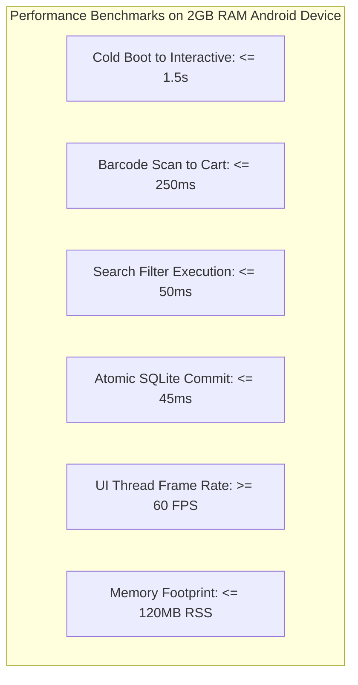

# Non-Functional Requirements Specification (NFRS)

> **Project**: Startup Tindahan Helper (*Juan's Store POS & Inventory System*)  
> **Standard Compliance**: ISO/IEC 25010:2023 (Systems and Software Quality Requirements and Evaluation - SQuaRE) & ISO/IEC/IEEE 29148:2018  
> **Traceability**: [BUSINESS_REQUIREMENTS.md](file:///c:/Developer/startupTindahanHelper/BUSINESS_REQUIREMENTS.md) · [FUNCTIONAL_REQUIREMENTS.md](file:///c:/Developer/startupTindahanHelper/FUNCTIONAL_REQUIREMENTS.md)  
> **Target Environment**: Entry-Level to Mid-Range Android (2GB–4GB RAM, Android 10+) & iOS 15+ via Expo SDK 57 and React Native 0.86

---

## 1. Specification Framework & Quality Attributes

This document defines the non-functional software quality attributes governing **Startup Tindahan Helper**, organized according to the **ISO/IEC 25010** software quality model:
1. **Performance Efficiency & Latency** (`NFR-PERF-xxx`)
2. **Reliability, Durability & Offline Autonomy** (`NFR-REL-xxx`)
3. **Usability, Ergonomics & Accessibility** (`NFR-USE-xxx`)
4. **Security, Privacy & Data Integrity** (`NFR-SEC-xxx`)
5. **Maintainability & Architectural Modularity** (`NFR-ARC-xxx`)
6. **Portability & Environmental Constraints** (`NFR-ENV-xxx`)

Every requirement includes quantified metric thresholds, test measurement protocols, and binary pass/fail verification methods.

---

## Section 1: Performance Efficiency & Latency (`NFR-PERF-xxx`)



### NFR-PERF-001: Cold Boot to Interactive Snapshot
- **Description**: The application MUST achieve full interactivity from a cold operating system launch within a strict latency ceiling.
- **Metric Threshold**:
  - Target: $\le 1.2\text{ seconds}$ on mid-range devices (Snapdragon 680 / 4GB RAM).
  - Upper Bound: $\le 1.5\text{ seconds}$ on entry-level budget hardware (MediaTek Helio A22 / 2GB RAM).
- **Measurement Protocol**: Measured from OS process launch (`Activity.onCreate`) until the root navigation layout renders the initial in-memory snapshot and responds to touch events.
- **Verification Method**: Benchmark via Android `adb shell am start-activity -W` averaged over 10 consecutive cold launches.

---

### NFR-PERF-002: Camera Viewfinder Barcode Detection Latency
- **Description**: The latency between presenting a valid commercial barcode (EAN-13, UPC-A) to the camera viewfinder and adding the item to the cart MUST NOT exceed real-time interactive thresholds.
- **Metric Threshold**:
  - Detection to Cart Update: $\le 250\text{ ms}$.
  - Haptic Trigger: $\le 50\text{ ms}$ post-detection.
- **Measurement Protocol**: High-speed 120 FPS camera capture measuring the interval between barcode entering the active viewfinder reticle and the UI toast/badge rendering on screen.
- **Verification Method**: Automated integration test using mock camera frame feeds measuring timestamp diff between `onBarcodeScanned` callback and store snapshot notification.

---

### NFR-PERF-003: Sub-50ms Search Debounce & Catalog Query Execution
- **Description**: Searching the local product catalog in Screens 1, 2, and 4 MUST execute without stutter or UI thread blockages.
- **Metric Threshold**:
  - Debounce Delay: $150\text{ ms}$.
  - SQLite FTS / LIKE Query Execution: $\le 50\text{ ms}$ for a catalog of 2,000 SKUs.
- **Measurement Protocol**: React Native performance profiler recording time spent in JavaScript thread during keystroke entry in search inputs.
- **Verification Method**: Benchmark script running 50 sequential query variations against a pre-populated 2,000-product SQLite database.

---

### NFR-PERF-004: Atomic Transaction Write Latency (SQLite WAL Mode)
- **Description**: Completing a sale, processing a return, or adjusting stock in SQLite MUST complete within an imperceptible timeframe to ensure instant checkout response.
- **Metric Threshold**: Execution time of `db.withTransactionSync` $\le 45\text{ ms}$ (including inserting transaction, updating stock counts, logging monthly demand, and updating customer credit balance).
- **Measurement Protocol**: High-resolution performance timer (`performance.now()`) wrapping the atomic transaction block in `TindahanStoreService.ts`.
- **Verification Method**: Automated unit/integration test executing 100 consecutive checkout transactions with standard deviation $\sigma \le 10\text{ ms}$.

---

### NFR-PERF-005: 60 FPS UI Thread Smoothness
- **Description**: All user interactions (scrolling the product grid, opening cart sheets, quantity stepping, navigation transitions) MUST maintain a minimum of 60 frames per second on the UI thread without jank.
- **Metric Threshold**:
  - UI Thread Frame Rate: $\ge 60\text{ FPS}$ (frame rendering time $\le 16.6\text{ ms}$).
  - Dropped Frames: $< 1\%$ across a 60-second continuous scroll test.
- **Measurement Protocol**: Systrace / Android Studio CPU Profiler profiling frame drop rates during rapid list flings and modal transitions.
- **Verification Method**: Automated Maestro UI gesture test flinging `ProductList` and `SalesHistory` for 60 seconds while logging Android Choreographer dropped frames.

---

### NFR-PERF-006: Memory Footprint & Resource Consumption
- **Description**: The total Resident Set Size (RSS) memory consumption of the app MUST remain strictly constrained to avoid OS-level background kills on 2GB RAM budget phones.
- **Metric Threshold**: Total Application Memory $\le 120\text{ MB}$ RSS under full operational load (camera scanner active + 1,000 products loaded in memory).
- **Measurement Protocol**: Monitored via Android `adb shell dumpsys meminfo` during 30 minutes of continuous scanning and checkout cycles.
- **Verification Method**: Automated stress test script executing 500 simulated sales; pass if memory leak gradient is zero ($\Delta\text{RSS} \le 5\text{ MB}$).

---

## Section 2: Reliability, Durability & Offline Autonomy (`NFR-REL-xxx`)

### NFR-REL-001: 100% Offline Autonomy (Zero-Network Architecture)
- **Description**: The entire application MUST operate with 100% functional autonomy without any active Wi-Fi, cellular, or Bluetooth connection.
- **Metric Threshold**:
  - Core POS Functions Available Offline: $100\%$.
  - Network Ping Requirement: Exactly $0$ network calls required for scan, cart, checkout, inventory, sales history, utang, and seasonal forecast.
- **Measurement Protocol**: Device placed in Airplane Mode with Wi-Fi and Cellular radios physically disabled; 100 sales, 10 returns, and 5 debt settlements executed.
- **Verification Method**: Binary Pass/Fail: All workflows complete successfully without presenting network timeout errors, spinner hangs, or disabled buttons.

---

### NFR-REL-002: ACID Compliance & Write-Ahead Logging (WAL) Mode
- **Description**: To prevent database corruption and optimize concurrent read/write operations, SQLite MUST be configured in Write-Ahead Logging (WAL) mode.
- **Implementation Constraint**:
  ```sql
  PRAGMA journal_mode = WAL;
  PRAGMA synchronous = NORMAL;
  PRAGMA busy_timeout = 5000;
  ```
- **Metric Threshold**: Zero database corruption incidents across 10,000 transactions; zero unhandled SQLite busy/lock errors.
- **Verification Method**: Automated crash test simulating ungraceful app termination (`SIGKILL`) during active `db.withTransactionSync` writes; verify integrity via `PRAGMA integrity_check` on restart.

---

### NFR-REL-003: Single Immutable Session Snapshot (`useSyncExternalStore`)
- **Description**: To eliminate React re-render loops, UI screen flicker, and multi-listener race conditions, store reads MUST be 100% pure in-memory projections bound via `useSyncExternalStore`.
- **Architectural Rules**:
  1. Zero SQLite queries during React render cycles.
  2. Zero re-hydration on screen focus (`useFocusEffect` MUST NOT trigger database re-reads).
  3. UI components receive the exact same object reference until an atomic mutation publishes a new snapshot.
- **Verification Method**: Code review audit and Jest test verifying reference equality:
  ```ts
  expect(store.getSnapshot()).toBe(store.getSnapshot()); // Must pass
  ```

---

### NFR-REL-004: Graceful Crash Recovery & Data Durability
- **Description**: In the event of battery exhaustion, operating system kill, or unexpected hardware reboot during a checkout transaction, the system MUST guarantee zero data loss of committed transactions and zero partial/corrupted records.
- **Metric Threshold**: Zero lost transactions; zero orphaned cart items; recovery time on reboot $\le 1.5\text{ seconds}$.
- **Verification Method**: Power-cut simulation on physical device during transaction write; verify that SQLite rolls back uncommitted changes and retains all previously committed sales.

---

## Section 3: Usability, Ergonomics & Accessibility (`NFR-USE-xxx`)

### NFR-USE-001: Minimum 48x48dp Touch Targets & Spacing
- **Description**: Operating a POS in a busy store window with wet, cold, or dusty hands requires large, forgiving touch targets.
- **Metric Threshold**:
  - Minimum Interactive Touch Target: $48 \times 48\text{ dp}$ (Android) / $44 \times 44\text{ pt}$ (iOS).
  - Minimum Physical Spacing Between Destructive/Adjacent Buttons: $\ge 12\text{ dp}$.
  - Stepper Controls (`−` and `+`): Minimum $48\text{ dp}$ effective touch area with `hitSlop={8}`.
- **Verification Method**: Automated layout audit via Android Accessibility Scanner; 0 violations allowed.

---

### NFR-USE-002: Thumb-Zone Ergonomic CTA Placement
- **Description**: Store owners frequently operate their phone with one hand while holding items or counting cash with the other. All primary call-to-action (CTA) buttons MUST reside in the bottom ergonomic thumb zone.
- **Metric Threshold**:
  - Primary CTAs (`Complete Sale`, `New Sale`, `Add More Items`, Cart FAB) MUST be positioned within the lower $35\%$ of the screen height.
  - No critical checkout action may require reaching into the top $15\%$ of the display.
- **Verification Method**: Visual layout inspection against Android Material 3 and iOS Human Interface Guidelines thumb-reach heatmaps.

---

### NFR-USE-003: Outdoor Glare Readability & WCAG AA Contrast Compliance
- **Description**: Philippine *sari-sari* stores are typically open to outdoor daylight, roadside dust, and direct afternoon glare ($50,000–100,000\text{ lux}$). Text and critical indicators MUST maintain extreme contrast.
- **Metric Threshold**:
  - Body Text Contrast Ratio: $\ge 4.5:1$ against background (WCAG AA).
  - Header & Price Displays: $\ge 7.0:1$ against background (WCAG AAA).
  - Negative Values / Shortage Warnings: High-contrast Dark Crimson (`#991B1B`) on Soft Pink (`#FEE2E2`).
- **Verification Method**: Color contrast analyzer automated audit across all 7 screens in both light and dark display modes.

---

### NFR-USE-004: Triple-Encoding of Critical Status Indicators
- **Description**: Stock availability and forecast indicators MUST NEVER rely on color alone, ensuring instant comprehension under blinding sunlight and for operators with color-vision deficiencies.
- **Metric Threshold**: Every status indicator MUST combine (1) Contrast Color + (2) Distinct Geometric Icon + (3) Explicit Text Label.
- **Implementation Standard**:
  - In Stock: Emerald Green + `●` Circle Icon + `"In Stock (X)"`.
  - Low Stock: Dark Amber + `▲` Warning Triangle + `"Low Stock (X)"`.
  - Out of Stock: Dark Crimson + `✕` Cross Icon + `"Out of Stock (0)"`.
- **Verification Method**: Automated visual regression testing ensuring all status badges render icon and text nodes in addition to background fill.

---

### NFR-USE-005: Multi-Sensory Audio-Haptic Feedback
- **Description**: Scanning goods in rapid succession requires immediate physical and auditory confirmation so the operator does not have to look at the screen for every item.
- **Metric Threshold**:
  - Success Feedback: `Haptics.NotificationFeedbackType.Success` + crisp 1200Hz synthesized audio tone $\le 50\text{ ms}$ post-scan.
  - Error Feedback: `Haptics.NotificationFeedbackType.Error` + double low-buzz audio tone $\le 50\text{ ms}$.
- **Verification Method**: Audio/haptic latency test verifying that feedback is dispatched synchronously upon barcode detection.

---

### NFR-USE-006: Bilingual Localization (English & Filipino/Tagalog)
- **Description**: The entire user interface MUST support seamless, 1-tap switching between English and Filipino/Tagalog.
- **Metric Threshold**:
  - Localization Coverage: $100\%$ of user-facing strings localized in `src/presentation/localization/i18n.ts`.
  - Language Switch Latency: Instant ($\le 100\text{ ms}$) upon setting change without requiring an application restart.
- **Verification Method**: Automated string parity test verifying that all dictionary keys in English have matching Filipino translations.

---

## Section 4: Security, Privacy & Data Integrity (`NFR-SEC-xxx`)

### NFR-SEC-001: Sandboxed Local Database Storage
- **Description**: The SQLite database file (`tindahan_pos_v3.db`) MUST reside exclusively within the application's private, sandboxed internal storage directory.
- **Metric Threshold**:
  - File permissions restricted to the application's Linux UID (mode `0600` on Android).
  - No database files or cached receipts stored in unencrypted public external storage without user-initiated export.
- **Verification Method**: Verify file path via `FileSystem.documentDirectory` and confirm inaccessible to third-party apps on non-rooted Android devices.

---

### NFR-SEC-002: Customer PII & Financial Privacy Protection
- **Description**: Suki customer names, phone numbers, individual credit limits, and debt histories represent sensitive neighborhood financial information and MUST NOT be exfiltrated.
- **Metric Threshold**:
  - External Cloud Transmission: Exactly $0$ bytes of customer personal data or transaction records sent to external servers.
  - Analytics / Crash Reporting: Zero telemetry tracking containing PII or transaction totals.
- **Verification Method**: Network packet inspection (Wireshark / Charles Proxy) during 100 checkout and utang management operations; verify zero outbound data packets.

---

### NFR-SEC-003: Barcode Injection & Input Sanitization
- **Description**: Malicious or malformed barcode strings (e.g., QR codes containing SQL injection payloads or terminal control escape sequences) MUST be strictly sanitized prior to execution.
- **Validation Rules**:
  - Strip all control characters, carriage returns, and newlines.
  - Parameterized SQLite queries exclusively; zero raw string concatenation for SQL execution:
    ```ts
    // Enforced standard:
    db.runSync('SELECT * FROM products WHERE barcode = ?', [sanitizedBarcode]);
    ```
- **Verification Method**: Automated security unit test passing SQL injection payloads (`' OR '1'='1`, `'; DROP TABLE products; --`) through scanner input; verify zero query syntax errors and zero unauthorized table modifications.

---

### NFR-SEC-004: Append-Only Immutable Audit Ledgers
- **Description**: Financial integrity requires that sales transactions, voids, returns, and cash drawer movements cannot be silently deleted or rewritten.
- **Implementation Standard**:
  - Voiding a sale writes a new status record; the original sale row remains intact with timestamped audit note.
  - Stock adjustments write an immutable entry to `shrinkage_logs` with timestamp and reason.
  - Cash drawer withdrawals write an immutable entry to `cash_drawer_adjustments`.
- **Verification Method**: Database schema audit confirming absence of `DELETE FROM sales_transactions` calls in application source code.

---

## Section 5: Maintainability & Architectural Modularity (`NFR-ARC-xxx`)

### NFR-ARC-001: Clean Architecture & Domain-Driven Modularity
- **Description**: The codebase MUST maintain strict separation of concerns across four decoupled layers:
  1. **Domain Layer (`src/domain/`)**: Pure TypeScript entities (`Product`, `Money`, `Barcode`), repository interfaces, and strategy pattern algorithms (`SeasonalForecastEngine`). Zero React Native or SQLite imports.
  2. **Application Layer (`src/application/`)**: Orchestration services (`TindahanStoreService`, `ProductOnboardingService`).
  3. **Infrastructure Layer (`src/infrastructure/`)**: Concrete implementations (`SqliteDatabase`, `SoundFeedbackService`).
  4. **Presentation Layer (`src/presentation/` & `src/app/`)**: Pure UI components, custom hooks (`useTindahanStore`, `useIdempotentSubmit`), and Expo Router screens.
- **Verification Method**: ESLint dependency boundaries rule enforcing that Domain files cannot import from Application, Infrastructure, or Presentation layers.

---

### NFR-ARC-002: Zero Floating-Point Currency Drift (Integer Centavos Standard)
- **Description**: Standard JavaScript floating-point arithmetic introduces rounding errors (e.g., `16.10 * 3 = 48.300000000000004`). All monetary calculations MUST be conducted in integer centavos.
- **Implementation Standard**:
  - Handled via `Money` value object or strict integer arithmetic (`₱54.00` = `5400`).
  - Formatted to string only at the presentation boundary via `Intl.NumberFormat('en-PH', { style: 'currency', currency: 'PHP' })`.
- **Verification Method**: Unit tests running 100,000 randomized split and discount transactions verifying zero penny drift:
  ```ts
  expect(Money.fromCentavos(1600).multiply(3).toCentavos()).toBe(4800);
  ```

---

### NFR-ARC-003: 100% Strict TypeScript Type Safety
- **Description**: To eliminate runtime `undefined is not a function` crashes in production, the application MUST pass strict TypeScript compilation without type assertions.
- **Compiler Configuration**:
  ```json
  {
    "compilerOptions": {
      "strict": true,
      "noImplicitAny": true,
      "strictNullChecks": true,
      "noEmit": true
    }
  }
  ```
- **Verification Method**: `npx tsc --noEmit` exits with status code 0 and zero compilation errors.

---

## Section 6: Portability & Environmental Constraints (`NFR-ENV-xxx`)

### NFR-ENV-001: Budget Mobile Hardware Compatibility
- **Description**: The application MUST operate reliably on entry-level Android devices commonly used by micro-retailers in the Philippines.
- **Minimum Hardware Specification**:
  - Operating System: Android 10 (API Level 29) or iOS 15.
  - RAM: 2.0 GB.
  - CPU: Quad-Core 1.8 GHz ARM Cortex-A53 (e.g., MediaTek Helio A22 / Snapdragon 429).
  - Storage: $\ge 150\text{ MB}$ free internal storage.
  - Camera: 5.0 Megapixel rear camera with autofocus.
- **Verification Method**: Physical test deployment and full regression run on a 2GB RAM Android 10 reference device (e.g., Xiaomi Redmi 9A or Samsung Galaxy A03 Core).

---

### NFR-ENV-002: Tropical Thermal & Battery Throttling Management
- **Description**: Operating a continuous camera viewfinder in ambient temperatures between $32^\circ\text{C}$ and $40^\circ\text{C}$ causes rapid device overheating, battery drain, and OS camera shutdown.
- **Mitigation Standard**:
  - Auto-Pause Camera: If no barcode is detected within 45 seconds on Screen 1, the camera viewfinder MUST automatically enter low-power sleep mode and display a `Tap to Wake Camera` overlay.
  - Battery Drain Limit: $\le 8\%$ battery consumption per hour of continuous POS operation.
- **Verification Method**: 1-hour thermal and battery profiling session under ambient $35^\circ\text{C}$ temperature.

---

## Section 7: Quality Verification & Testability Matrix

| Requirement ID | Quality Category | Target Metric | Verification Method | Automated Tooling |
| :--- | :--- | :--- | :--- | :--- |
| **NFR-PERF-001** | Performance | Cold Boot $\le 1.5\text{s}$ | Cold launch timing benchmark | Android `adb am start -W` |
| **NFR-PERF-002** | Performance | Scan Latency $\le 250\text{ms}$ | Frame timestamp diff | Jest + Mock Camera Frames |
| **NFR-PERF-004** | Performance | SQLite Commit $\le 45\text{ms}$ | Transaction execution timer | Jest Benchmark Suite |
| **NFR-PERF-005** | Performance | Frame Rate $\ge 60\text{ FPS}$ | Choreographer dropped frames | Maestro UI Flings + Systrace |
| **NFR-PERF-006** | Performance | Memory RSS $\le 120\text{MB}$ | Memory footprint dump | `adb shell dumpsys meminfo` |
| **NFR-REL-001** | Reliability | 100% Offline Autonomy | Airplane mode regression | Network Isolation Test |
| **NFR-REL-002** | Reliability | Zero SQLite Corruption | Crash during write simulation | `PRAGMA integrity_check` |
| **NFR-REL-003** | Reliability | Pure Snapshot Reads | Reference equality assertion | Jest Store Snapshot Tests |
| **NFR-USE-001** | Usability | $\ge 48\times 48\text{dp}$ Touch Targets | Accessibility scanner audit | Android Accessibility Scanner |
| **NFR-USE-003** | Usability | Contrast $\ge 4.5:1$ (AA) | Color contrast inspection | Automated Contrast Analyzer |
| **NFR-USE-006** | Usability | 100% Bilingual Strings | Dictionary key parity test | Jest Localization Linter |
| **NFR-SEC-002** | Security | 0 Bytes PII Exfiltration | Network packet inspection | Wireshark / Charles Proxy |
| **NFR-SEC-003** | Security | SQL Injection Immune | Fuzzing with SQL attack vectors | Jest Security Injection Suite |
| **NFR-ARC-002** | Maintainability | Zero Penny Drift | 100,000 randomized calculations | Jest Integer Centavos Test |
| **NFR-ARC-003** | Maintainability | Strict TypeScript 0 Errors | Compiler validation | `npx tsc --noEmit` |
| **NFR-ENV-002** | Environmental | Camera Sleep at 45s | Inactivity timer test | Jest Fake Timers Suite |
