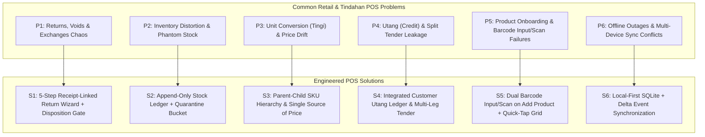
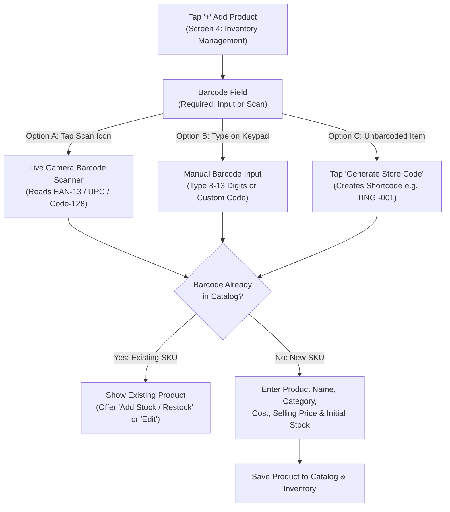
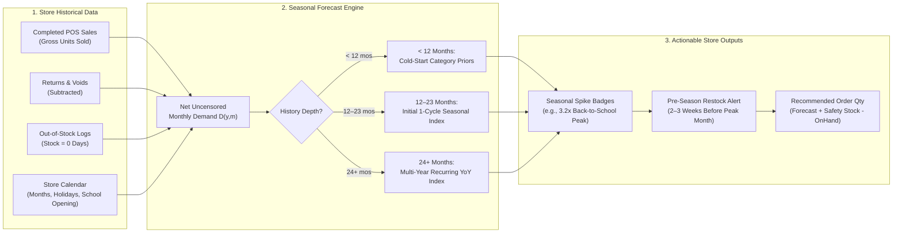

# POS System Common Problems, Solutions & Feature C: Seasonal Product Forecast

> **Project**: Startup Tindahan Helper (*Juan's Store POS & Inventory System*)  
> **Research Engine**: AnySearch (Retail POS Workflows, Return/Void/Exchange Loss Prevention, Philippine *Sari-Sari Store* Operations, & Academic/Industry Seasonal Demand Forecasting)  
> **Reference UI Prototype**: [Gemini_Generated_Image_tx51cztx51cztx51.jpg](file:///c:/Developer/startupTindahanHelper/ui/Gemini_Generated_Image_tx51cztx51cztx51.jpg)

---

## Executive Summary

Point-of-Sale (POS) systems for neighborhood retail stores and Philippine *sari-sari* stores (*tindahan*) frequently fail not at basic barcode checkout, but at **exception handling** (returns, voids, exchanges, damaged stock, offline sync, *tingi* unit conversions, *utang* credit tracking) and **forward-looking inventory planning** (**Feature C: Seasonal Product Forecast**).

According to retail industry research gathered via **AnySearch**:
- **Inventory distortion** (stockouts + overstock + transaction discrepancies) costs the global retail sector **$1.73 trillion annually**, while **mishandled returns and return fraud** account for **$101 billion** in losses.
- Small retailers and *tindahan* owners suffer chronic profit leakage when returns are processed without tying back to the original receipt, when defective returned goods are automatically returned to sellable stock ("phantom inventory"), or when seasonal peaks (such as **Back-to-School** supplies, *Noche Buena*, or summer beverages) catch the store unprepared due to backward-looking static reorder thresholds.

This document provides:
1. **A Visual & Functional Audit** of the 7-screen **Juan's Store POS UI Prototype** (operated exclusively by the **Store Owner** — `Juan's Store • Owner` as shown in Screen 6, eliminating multi-role cashier vs. manager complexity in favor of fast, owner-centric self-audit safeguards).
2. **A Comprehensive Catalog of Common POS Problems & Mitigations** (covering Returns, Voids, Exchanges, Inventory Distortion, *Tingi* Multi-Unit Conversions, *Utang* Credit & Split Payments, Barcode Scanning Edge Cases, and Offline-First Sync).
3. **A Complete Specification for Feature C: Seasonal Product Forecast** (comparing same-month sales across previous years using 12-month initial cycles and 24+ month multi-year recurring patterns, complete with a worked **School Supplies vs. Ordinary Months** mathematical model and solutions to 7 seasonal forecasting edge cases).

---

## Part 1: Audit of the Current Juan's Store POS UI Prototype

The current mobile UI prototype ([Gemini_Generated_Image_tx51cztx51cztx51.jpg](file:///c:/Developer/startupTindahanHelper/ui/Gemini_Generated_Image_tx51cztx51cztx51.jpg)) defines **7 core screens** for **Juan's Store** (`123 Market St., San Jose, Nueva Ecija`):

| Screen # | Screen Name | Current Capabilities Shown in Prototype | Identified Operational Gaps |
| :--- | :--- | :--- | :--- |
| **1** | **POS / Scan Product** | Camera barcode viewfinder (scanning *Piattos BBQ*), search bar, 2x2 quick product grid (*Piattos BBQ ₱16.00*, *C2 Iced Tea ₱16.00*, *Lucky Me! Pancit Canton ₱14.00*, *Nescafe 3in1 ₱16.00*), bottom navigation with center Cart FAB. | No fallback button for crumpled/unbarcoded *tingi* items; no held-basket/park-sale toggle; price mismatch noticed between Screen 1 (*Piattos ₱16.00*) and Screen 2 (*Piattos ₱12.00*). |
| **2** | **Product List** | Search input, filter icon, category pills (`All`, `Beverages`, `Snacks`, `Groceries`), vertical item list with stock badges (`In stock`, `Low Stock`). | Missing `School Supplies` / `Seasonal` category tags; no multi-unit (*piece / pack / case*) indicator; no seasonal demand badge. |
| **3** | **Checkout / Sales (`New Sale`)** | Line items with `- 1 +` stepper controls, `Subtotal (₱54.00)`, `Discount (₱0.00)`, `Total (₱54.00)`, `Complete Sale` CTA, `+ Add More Items` CTA, trash icon to clear cart. | Missing payment tender selector (`Cash`, `GCash/Maya`, `Utang / Credit`, `Split Payment`); no cash-tendered & change calculator; no option to process an **Exchange** credit against a new purchase. |
| **4** | **Inventory Management** | Status filter pills (`All`, `In Stock`, `Low Stock`, `Out of Stock`), `+` Add Product button, stock count per SKU (*Piattos: 24*, *C2: 16*, *Pancit Canton: 5 Low Stock*, *Nescafe: 12*, *Sprite: 30*, *Coca-Cola: 0 Out of Stock*). | Tapping `+` (`Add Product`) needs a dedicated **Barcode Input or Scan** workflow; static low-stock threshold (does not adapt to upcoming seasonal spikes); no record of *when* `Coca-Cola 500ml` hit `Stock: 0` (censoring true demand); no separated `Damaged / Expired / Quarantine` stock bucket. |
| **5** | **Sales History** | Period tabs (`Daily`, `Weekly`, `Monthly`), date picker (`Apr 25, 2025`), summary cards (`Sales Today ₱842.00`, `Total Items 42`, `Transactions 18`), `Recent Transactions` list (`10:24 AM ₱84.00 3 Items`, etc.). | No transaction detail drill-down showing `Void`, `Return Item`, or `Exchange Item` actions; no filter for `Refunded` or `Voided` receipts; no Net Sales vs. Gross Sales breakdown. |
| **6** | **Menu / Profile** | Store header (`Juan's Store - Owner`), navigation links (`Store Settings`, `Products`, `Sales Reports`, `Inventory`, `Online Store`, `Subscription Free`, `Help & Support`, `Log Out`). | `Sales Reports` needs a dedicated **Seasonal Product Forecast** module and a **Returns & Shrinkage Audit Report**. |
| **7** | **Settings (`Store Settings`)** | `Store Name`, `Store Logo`, `Address`, `Language (English)`, `Notifications` toggle. | Missing **Return Policy Window** setting, **School Opening / Local Fiesta Calendar Dates** configuration, and **Offline Backup / Sync Status** controls. |

---

## Part 2: Common POS System Problems & Comprehensive Solutions

### Problem 1: Product Returns, Refunds, Exchanges, and Transaction Voids (Owner-Operated Workflow)

#### Why It Happens (Root Causes)
1. **Void vs. Refund Confusion**: Even when the **Store Owner** operates the POS directly, an accidental double-scan or wrong payment tap made seconds ago (which should be a **Same-Day Void**) is often treated the same as a customer bringing back an item hours later (which is a **Return/Refund**), or vice versa.
2. **Unlinked "Blind" Returns**: Processing a refund without looking up the original transaction in **Screen 5 (`Sales History`)** can cause the owner to refund the single-piece price (`₱16.00`) when the customer actually bought the 2-piece bundle promo (`₱12.00` per piece / `₱24.00` for 2).
3. **Automatic Restocking of Defective Goods (Phantom Inventory)**: When a customer returns a spoiled beverage or open snack packet, naive POS systems automatically increment `Stock + 1`. The system now thinks the item is sellable (`In Stock`), causing **phantom inventory** and distorting reorder alerts.
4. **Exchange Double-Counting**: When a customer swaps a ₱14.00 *Lucky Me! Pancit Canton* for a ₱16.00 *C2 Iced Tea*, doing a manual workaround instead of an atomic exchange either double-counts revenue or fails to adjust both SKUs' stock counts.
5. **Distorted Sales History**: If returns and voids are not linked to the original product and period, historical sales remain artificially inflated—corrupting **Feature C (Seasonal Product Forecast)**.

#### Complete Solution Architecture (Single-User Owner Model)

| Operation | When Owner Uses It | Inventory Impact | Financial / Audit Impact |
| :--- | :--- | :--- | :--- |
| **Cancel Cart (Trash Icon)** | Before tapping `Complete Sale` (Screen 3) | None (stock was never deducted) | 1-tap Owner confirmation modal (or `Park / Hold Cart` option) prevents accidental clears. |
| **Same-Day Transaction Void** | Owner rang up wrong item/payment by mistake; corrected same day | Automatically reverses deduction (`Stock + Qty`) | Marks original receipt `VOIDED`; excluded from Gross & Net Sales and Seasonal Forecast history. |
| **Post-Sale Return (Refund)** | Customer brings back item after leaving store | **Gated by Condition**: `Sellable` $\rightarrow$ `Stock + Qty`; `Damaged/Expired` $\rightarrow$ `Quarantine/Bad Order + Qty` (does **not** increment sellable stock) | Creates negative adjustment entry linked to original `Receipt_ID`; reduces Net Sales. |
| **Atomic Product Exchange** | Customer swaps returned item(s) for replacement item(s) in one flow | Returned SKU follows Condition Gate (`Sellable` vs. `Damaged`); Replacement SKU deducts `Stock - Qty` | Computes net difference $\Delta = \text{New Cart Total} - \text{Return Credit}$; owner collects or refunds only $\Delta$. |

#### Step-by-Step Guided Owner Return & Exchange Workflow (Screen 5 Integration)
1. **Locate Original Transaction**: In **Screen 5 (`Sales History`)**, the owner taps the transaction (`10:24 AM • ₱84.00 • 3 Items`).
2. **Select Return / Exchange / Void**: Tap `Return / Exchange Items` (or `Void Entire Sale` for entry mistakes).
3. **Select Returned Line Item(s)**: Enforces quantity cap ($\text{Return Qty} \le \text{Original Purchased Qty} - \text{Previously Returned Qty}$).
4. **Mandatory Reason & Condition Disposition**:
   - **Reason Code**: `Defective / Spoiled`, `Expired`, `Wrong Item Bought`, `Changed Mind`, `Owner Entry Error`.
   - **Disposition Bucket**:
     - `Restock as Sellable` (increments active `In Stock` count in Screen 4).
     - `Damaged / Write-Off / Bad Order (B.O.)` (logs shrinkage/supplier return; keeps sellable stock unchanged).
5. **Select Resolution Method**:
   - `Cash Refund`, `GCash Reversal`, `Deduct from Utang Balance`, or `Instant Exchange` (opens Screen 3 `New Sale` with the return credit pre-applied).

---

### Problem 2: Inventory Distortion, Shrinkage & Unrecorded Stock Movements

#### Why It Happens
- **Unrecorded Non-Sale Deductions**: In family-run *sari-sari* stores, household members frequently take snacks, cooking oil, or coffee from store shelves for personal consumption (*sariling gamit*) without ringing it into the POS.
- **Spoilage, Rodent/Pest Damage, and Expiration**: Items expire on the shelf or get damaged, making physical stock lower than POS stock.
- **Supplier Short-Deliveries**: Restock deliveries are entered at invoice quantity rather than physically counted quantity.

#### Solution
- **Quick Stock Adjustment with Reason Codes (Screen 4)**: Tapping any product in `Inventory Management` opens a `Stock Adjustment` sheet requiring a reason tag:
  - `+ Receive Delivery / Restock` (records unit cost & optional expiry date)
  - `- Owner / Household Consumption` (tracks at cost so store profitability remains accurate)
  - `- Expired / Spoiled / Damaged` (tracks shrinkage rate per SKU)
  - `= Physical Audit Count` (reconciles system stock to shelf count and logs variance)
- **FEFO (First-Expired, First-Out) Expiry Alerts**: Optional batch expiration date field on restock that triggers a 30-day warning badge in Screen 4 before goods expire.

---

### Problem 3: Multi-Unit Selling (*Tingi* vs. Pack vs. Case) & Price Inconsistency

#### Why It Happens
- Look closely at the UI prototype ([Gemini_Generated_Image_tx51cztx51cztx51.jpg](file:///c:/Developer/startupTindahanHelper/ui/Gemini_Generated_Image_tx51cztx51cztx51.jpg)):
  - In **Screen 1 (`POS / Scan Product`)** and **Screen 3 (`New Sale`)**, *Piattos BBQ* is listed at **₱16.00** (yet 2 units in Screen 3 total **₱24.00**, which is $2 \times \text{₱12.00}$!), whereas in **Screen 2 (`Product List`)**, *Piattos BBQ* is listed at **₱12.00**.
  - This exact discrepancy happens in real POS systems when **single-piece retail price**, **wholesale/bundle tier price** (e.g., 2 for ₱24.00), or **unit variants** (single sachet vs. twin-pack vs. 10-pack bundle) are stored as disconnected records instead of a unified catalog entity.
- Furthermore, stores buy in **cases/boxes/ties** (e.g., 1 case of Lucky Me! = 72 packs; 1 tie of Nescafe = 10 sachets; 1 ream of pad paper = 10 pads) and sell by **piece (*tingi*)** or **half-dozen**.

#### Solution
- **Single Source of Truth Catalog Schema with Unit Conversion**:
  - Maintain a **Base Unit** (e.g., `1 piece / sachet`) for inventory tracking.
  - Define **Selling Units & Bundle Tiers** mapped to the same base inventory pool:
    - `1 Piece` = deducts `1` base unit (₱16.00)
    - `Bundle of 2+` = deducts `2` base units (Promo tier: ₱12.00 each / ₱24.00 total)
    - `1 Pack (6 pcs)` = deducts `6` base units
    - `1 Case (24 pcs)` = adds `24` base units when receiving stock from supplier

---

### Problem 4: Payment Tender Input Errors, Underpayment, Neighborhood Credit (*Utang*) & Split Payments

#### Why It Happens (Root Causes & Why Preset Cash Buttons Alone Fail)
- **Why Preset Bill Buttons Alone Fail in Real Checkout**: Relying only on preset denomination buttons (`₱60`, `₱100`, `₱200`, `₱500`) without a **manual user-input `Payment / Amount Received (₱)` field** fails whenever a customer hands an odd combination of bills and coins—for example, handing **`₱64.00`** for a **`₱54.00`** purchase so the owner can return a single whole **`₱10.00`** coin instead of draining the store's `₱1` coin supply (*barya*), or handing `₱75.00`, `₱150.00`, etc.
- **Unvalidated Underpayments at Checkout**: As documented in enterprise POS standards (Oracle Retail Xstore POS / Microsoft Dynamics 365 Commerce POS), if the operator taps `Complete Sale` without entering the tendered amount—or enters an amount smaller than `Total Due` (`Amount Received < Total`)—naive POS apps either complete the sale with `₱0` tendered or miscalculate change due.
- **Unverified GCash Payments**: Accepting GCash without an input field for the **GCash Reference Number (last 4 digits)** exposes the owner to fake screenshot scams.
- **Paper *Utang* Notebook Leakage**: *Sari-sari* stores extend informal credit (*utang* / *lista*) to regular neighborhood customers (*suki*). If an *utang* or partial-payment transaction is not recorded in the POS SQLite database at the moment items leave the shelf, **inventory counts immediately become wrong** and **seasonal demand timing is lost**.

#### Solution
- **Mandatory User-Input Payment Amount (`TextInput`) + Quick-Fill Helper Chips (Screen 3 `New Sale`)**:
  - Provide a dedicated numeric **`Amount Received / Tendered (₱)` `TextInput`** (`keyboardType="decimal-pad"`) where the store owner types the exact cash or GCash amount received from the customer, paired with optional quick-fill pills (`Exact`, `₱60`, `₱100`, `₱200`, `₱500`, `₱1000`) that populate the input field.
  - Provide a dedicated numeric **`Discount (₱)` `TextInput`** so the owner can type any exact discount amount.
  - **Real-Time Underpayment Guard & Change Calculator**:
    - When `Amount Received >= Total`: Automatically computes and highlights **`Change Due: ₱XX.XX`**.
    - When `Amount Received < Total` (on `Cash` or `GCash` sales): Displays **`⚠️ Short by ₱XX.XX — Enter full payment or charge balance to Utang`** and blocks `Complete Sale` until valid payment is entered, or lets the owner 1-tap **`Charge Deficit to Customer Utang`** (split cash + *utang* settlement).
- **Separate Demand Event from Cash Settlement Event**:
  - When a customer buys on credit, checkout records the sale **immediately on that day** in `expo-sqlite` under tender type `Utang (Credit Ledger)`, deducting inventory and preserving true demand timing for **Feature C (Seasonal Product Forecast)**.

---

### Problem 5: Product Registration & Checkout Barcode Handling (Must Support Manual Input or Camera Scan)

#### Why It Happens
- **Friction When Adding New Products (`+` Button in Screen 4)**: When onboarding new inventory, some items have clean barcodes that are fastest to scan with the camera, while other items have damaged/curved labels where the camera struggles to focus and the owner needs to **manually type the barcode digits** (e.g., `6800056520709`). If a POS forces only one method (scan-only or manual-only), product registration becomes slow or error-prone.
- **Duplicate SKU Creation**: Without instant barcode lookup during product creation, an owner might accidentally register *Piattos BBQ* twice under slightly different names, splitting sales history and breaking **Feature C (Seasonal Product Forecast)**.
- **Physical Packaging Issues at Checkout**: Crumpled foil snack bags (*Piattos*, *Pancit Canton*), wet/frosted beverage bottles (*C2*, *Sprite*, *Coca-Cola* straight from the cooler), and curved sachets distort camera reads.
- **Unbarcoded Goods**: Repacked sugar, salt, cooking oil, charcoal, ice, and individual pieces of school supplies (single ballpens, single sheets of pad paper or cartolina) have no manufacturer barcode.

#### Solution: Dual-Mode Barcode Input/Scan on Product Creation & Checkout

1. **Mandatory Dual-Mode Barcode Field When Adding a Product (`Screen 4` $\rightarrow$ `+` Button)**:
   - **Mode A — Camera Scan (`[Scan]` Button Inside Barcode Input)**: Opens the inline camera scanner (with flashlight toggle), locks onto the barcode (e.g., `6800056520709`), plays a confirmation beep, and populates the barcode field automatically.
   - **Mode B — Manual Barcode Input (Numeric/Alphanumeric Keypad)**: Lets the store owner directly type the barcode numbers printed beneath the barcode stripes when a wrapper is crumpled/torn, or enter a custom code. Includes automatic **EAN-13 / UPC Check-Digit Validation** to warn against typos.
   - **Mode C — Custom Code Generator for Unbarcoded *Tingi* Items**: For repacked goods or single school supply pieces without a factory barcode, a 1-tap `Generate Code` button assigns a clean internal barcode/shortcode (e.g., `#01` or `SCH-PAD-01`).
2. **"Scan-to-Create" Shortcut from POS Checkout (`Screen 1`)**:
   - If a cashier scans an unrecognized barcode in **Screen 1 (`POS / Scan Product`)**, the app immediately offers `"Barcode not yet registered — + Add Product"`, opening the `Add Product` modal with the scanned barcode **already pre-filled**.
3. **Instant Duplicate Barcode Guard**:
   - Whether a barcode is **typed manually or scanned**, the system immediately queries local inventory. If the barcode already exists, it blocks duplicate creation and offers a 1-tap jump to **`+ Restock Existing Item`** or **`Edit Product`**.
4. **Hybrid Fast-Checkout Fallback (`Screen 1`)**:
   - Keeps the split-screen layout in Screen 1 (camera scanner on top + quick-tap product grid on bottom) and adds a `No Barcode / Tingi` filter pill so unbarcoded items can be rung up in 1 tap.

---

### Problem 6: Offline Connectivity Outages & Multi-Device Sync Conflicts

#### Why It Happens
- Mobile data inside concrete store structures or rural barangays drops frequently. Cloud-only POS apps freeze at `Complete Sale`, causing long lines at the store window.
- When an owner checks inventory on their phone while a helper rings up sales on a counter tablet offline, naive last-write-wins syncing overwrites stock counts (`Stock = 24` overwrites `Stock = 20`).

#### Solution
- **Offline-First Architecture with CRDT / Event-Sourced Stock Ledger**:
  - Store all catalog, inventory, and sales data locally on-device (SQLite / IndexedDB) so Screens 1–5 operate with zero latency offline.
  - Sync **immutable stock movement events** (`SALE -2`, `RESTOCK +24`, `RETURN_SELLABLE +1`, `DAMAGE -1`) rather than mutable `current_stock` integers. When devices reconnect, summing the event log yields the exact, conflict-free inventory balance.

---

## Part 3: Feature C — Seasonal Product Forecast (Deep-Dive Specification)

> **Feature Requirement**:  
> **C. Seasonal Product Forecast**  
> *Identify products that tend to sell more during particular months, holidays, or school-opening periods.*  
> *Example*: Compare sales of school supplies before the school year with sales during ordinary months.  
> *Method*: Compare the same month across previous years and use the store's actual sales history. Around 12 months provides an initial seasonal cycle; 24 months or more gives better evidence of recurring patterns.

---

### 1. How Seasonal Product Forecasting Works

### 2. Mathematical Model & Forecasting Formulas

#### Step 1: Compute Clean, Uncensored Monthly Net Demand ($D_{i, y, m}$)
Raw POS sales often misrepresent true customer demand because of **voids/returns** (which inflate sales) and **stockouts** (which cap sales when the shelf is empty). For product $i$ in year $y$ and month $m \in \{1 \dots 12\}$:

$$D^{\text{net}}_{i, y, m} = \text{GrossUnitsSold}_{i, y, m} - \text{VoidedUnits}_{i, y, m} - \text{ReturnedChangedMindUnits}_{i, y, m}$$

*(Note: If an item was returned because it was defective and immediately exchanged for another unit of the same item, the customer still demanded 1 unit—only the defective physical unit is written off).*

Next, if the product was `Out of Stock` (`Stock == 0` in Screen 4) for $d_{\text{oos}}$ days out of $N_m$ total store-open days in month $m$, we adjust for **stockout-censored demand** (capped at a maximum $2.0\times$ multiplier to avoid division blowup):

$$D_{i, y, m} = D^{\text{net}}_{i, y, m} \times \min\left(2.0,\; \frac{N_m}{\max(1,\; N_m - d_{\text{oos}})}\right)$$

#### Step 2: Compute Ordinary Baseline Demand ($\bar{D}_{i, y}$)
For each 12-month cycle $y$, calculate the store's average monthly baseline demand for product $i$:

$$\bar{D}_{i, y} = \frac{1}{12} \sum_{m=1}^{12} D_{i, y, m}$$

We can also compute the **Ordinary Month Average** ($\bar{D}^{\text{ordinary}}_{i, y}$), which averages only the non-peak months (months where sales are within normal variance), providing a stark contrast for store owners comparing peak season vs. ordinary months.

#### Step 3: Compute Monthly Seasonal Index ($SI_{i, m}$) Across Years
For month $m$ across $K$ available historical years ($K = 1$ for 12–23 months of history; $K \ge 2$ for 24+ months of history):

$$SI_{i, m} = \frac{1}{K} \sum_{k=1}^{K} \frac{D_{i, y_k, m}}{\bar{D}_{i, y_k}}$$

- **$SI_{i, m} = 1.00$**: Month $m$ performs exactly at the annual average.
- **$SI_{i, m} \ge 1.30$**: Product $i$ has a **Seasonal Surge** (+30% or higher above average) in month $m$.
- **$SI_{i, m} \ge 2.00$**: Product $i$ is a **High-Seasonality Driver** (sells $2\times$ or more during month $m$, typical of school supplies before school opening or *Noche Buena* ingredients in December).

#### Step 4: Verify Multi-Year Recurring Consistency (24+ Months Evidence Score)
Why does the requirement state *"Around 12 months provides an initial seasonal cycle; 24 months or more gives better evidence of recurring patterns"*?
- With **12 months ($K=1$)**, a spike in July could be either a true recurring seasonal event (Back-to-School) **or** a one-off anomaly (e.g., a neighbor bought 50 notebooks for a charity drive).
- With **24+ months ($K \ge 2$)**, we compare the same month across Year 1 and Year 2 ($SI_{i, y_1, m}$ vs. $SI_{i, y_2, m}$):
  - **Recurring Pattern Confirmed**: Both Year 1 and Year 2 show $SI_{i, m} \ge 1.30$ in the same month/window, and the coefficient of variation across years is low.
  - **Confidence Tier Assignment**:
    - `Low / Provisional (< 12 months)`: Uses category seasonal priors + recent velocity.
    - `Medium / Initial Cycle (12–23 months)`: 1 year of actual store history ($K=1$).
    - `High / Recurring Pattern (24+ months)`: Verified across 2+ consecutive annual cycles ($K \ge 2$).

#### Step 5: Generate Next-Season Demand Forecast & Reorder Quantity
Using the recent Trailing 12-Month (T12M) baseline trend $\hat{B}_{i}$ (which accounts for whether Juan's Store is growing overall year-over-year):

$$\hat{D}_{i, \text{next}, m} = \hat{B}_{i} \times SI_{i, m}$$

$$\text{Recommended Restock}_{i, m} = \max\left(0,\; \lceil \hat{D}_{i, \text{next}, m} + \text{SafetyStock}_{i, m} - \text{CurrentStock}_i \rceil\right)$$

---

### 3. Worked Concrete Example: School Supplies Before School Year vs. Ordinary Months

Suppose **Juan's Store** tracks **Intermediate Pad Paper (80 leaves)** and **Black Ballpens** across **24 months** (2024–2025, where Philippine school opening occurs in late July / early August, making **July** the pre-school-year preparation peak):

| Product SKU | Ordinary Months Avg (Sep–May) | Year 1 Peak (July 2024) | Year 2 Peak (July 2025) | Annual Monthly Mean ($\bar{D}$) | Seasonal Index ($SI_{\text{July}}$) | Peak vs. Ordinary Multiplier | Pattern Classification (24 Months) |
| :--- | :---: | :---: | :---: | :---: | :---: | :---: | :--- |
| **Intermediate Pad Paper** | 14 pads / mo | 92 pads | 104 pads | 24.5 pads / mo | **$4.00\times$** | **$7.0\times$ vs. ordinary** | **Verified Recurring Peak** (School Opening) |
| **Black Ballpen (Piece)** | 28 pcs / mo | 135 pcs | 149 pcs | 41.0 pcs / mo | **$3.46\times$** | **$5.1\times$ vs. ordinary** | **Verified Recurring Peak** (School Opening) |
| **Composition Notebook** | 9 pcs / mo | 110 pcs | 122 pcs | 21.2 pcs / mo | **$5.47\times$** | **$12.9\times$ vs. ordinary** | **Verified Recurring Peak** (School Opening) |
| **C2 Iced Tea (Lunch Baon)** | 110 btls / mo | 165 btls | 180 btls | 122.0 btls / mo | **$1.41\times$** | **$1.57\times$ vs. ordinary** | **Verified Moderate Surge** (School Lunch *Baon*) |

**Actionable Output Shown to Juan's Store Owner on June 25 (3 Weeks Before Peak)**:
> **Back-to-School Restock Alert (High Confidence — 24 Months History)**  
> - **Composition Notebook**: Sells **$12.9\times$ more** before school opening (`116 pcs` average in July vs. `9 pcs` in ordinary months). Current Stock: `12`. **Recommended Restock: +115 pcs**.  
> - **Intermediate Pad Paper**: Sells **$7.0\times$ more** in July (`98 pads` expected vs. `14 pads` in ordinary months). Current Stock: `8`. **Recommended Restock: +95 pads**.

---

### 4. Common Problems in Seasonal Product Forecasting & Their Solutions

Even with the Seasonal Index formula above, real-world retail POS systems encounter **7 critical seasonal forecasting problems**. Below is each problem and its engineered solution:

#### Problem C1: The "Cold-Start" Problem (New Stores or New SKUs with < 12 Months of Data)
- **The Problem**: A newly onboarded *tindahan* using the app for only 3 months has no prior-year data for July (Back-to-School) or December (Christmas). Waiting 12–24 months before giving any seasonal advice leaves the owner blind during their first full year.
- **The Solution (3-Tier Progressive Hybrid Engine)**:
  1. **Months 1–11 (Cold-Start Mode)**: Map every product category to a built-in **Philippine Micro-Retail Seasonal Profile** (e.g., `School Supplies` $\rightarrow$ Pre-School-Opening spike; `All-Purpose Cream / Condensed Milk / Pasta` $\rightarrow$ December *Noche Buena* spike; `Cold Beverages / Halo-Halo Ingredients` $\rightarrow$ March–May *Tag-init* summer spike; `Candles / Bottled Water` $\rightarrow$ late October *Undas* spike; `Cough Drops / Instant Soup / Umbrellas` $\rightarrow$ June–October *Tag-ulan* rainy season). Multiply the store's current ordinary-month baseline by the category's regional seasonal multiplier, clearly labeled with a **`Provisional (Category Benchmark)`** badge.
  2. **Months 12–23 (Initial Cycle Mode)**: Transition to $70\%$ store-specific Year 1 Seasonal Index + $30\%$ category prior (Bayesian shrinkage to prevent over-fitting to single-year noise), labeled **`1-Year Store Cycle`**.
  3. **Months 24+ (Verified Recurring Mode)**: Use $100\%$ store-specific multi-year Year-over-Year seasonal indices with recency weighting ($0.6 \times Y_{t-1} + 0.4 \times Y_{t-2}$), labeled **`Verified Recurring Pattern (24m+)`**.

#### Problem C2: Stockout-Censored Demand (Out-of-Stock Hiding the True Peak)
- **The Problem**: Suppose last July, Juan's Store only had 30 notebooks, sold all 30 in the first 5 days of July, and remained `Out of Stock` (`Stock: 0`) for the remaining 26 days of July. A naive POS forecast looks at July's sales (`30 units`) and concludes demand is only 30 notebooks—repeating the exact same stockout next year!
- **The Solution (In-Stock Availability Imputation)**:
  - Automatically log `out_of_stock_started_at` and `restocked_at` timestamps whenever a product hits `Stock: 0` in **Screen 4 (`Inventory Management`)**.
  - Compute the **Daily Velocity While In-Stock** ($\frac{30\text{ units}}{5\text{ in-stock days}} = 6\text{ units/day}$) and project uncensored monthly demand across the peak window, flagging the historical record with *"Stockout-Adjusted: Sold out in 5 days last year"*.

#### Problem C3: Shifting School-Opening Calendars & Movable Holidays
- **The Problem**: Same-month Year-over-Year comparison breaks when the event itself moves across calendar months. For example, Philippine school openings shifted between June, August, and July across recent DepEd transition years, and Holy Week (*Semana Santa*) shifts between March and April. Comparing July 2026 directly to July 2023 without event alignment compares a back-to-school month to an ordinary mid-break month.
- **The Solution (Dual Calendar + Event-Anchor Alignment)**:
  - Store both the **Calendar Month ($m \in 1..12$)** and **Event-Relative Window** (`T-21 to T+7 days around School Opening Date`, `T-7 to T+0 days around Holy Week`, `Barangay Fiesta Week`).
  - In **Screen 7 (`Store Settings`)**, allow the store owner to set their local `School Opening Date` and `Local Fiesta Date` each year. The forecast engine aligns historical Back-to-School demand to the `School Opening Window` rather than rigidly assuming the same calendar week.

#### Problem C4: One-Off Bulk Outliers Masquerading as Seasonality
- **The Problem**: In a store with 12 months of data, if a local basketball tournament or wake (*lamay*) bought 200 cups of *Nescafe 3in1* and 150 packs of *Piattos* in February, a 12-month algorithm will falsely predict every February is "Piattos & Coffee Peak Season."
- **The Solution (Transaction-Level Anomaly Trimming & 24-Month Confirmation)**:
  - **Statistical Winsorization**: Flag single transactions whose quantity exceeds $\mu + 3\sigma$ of normal basket size (or allow cashier to toggle `One-Time Bulk Order` at checkout).
  - **Multi-Year Recurrence Gate**: Require a spike to appear across **at least 2 separate cycles (24+ months)**—or align with a known seasonal event calendar—before upgrading its status from `One-Time Spike` to `Recurring Seasonal Pattern`.

#### Problem C5: SKU Proliferation, Brand Switching & Short Product Lifecycles
- **The Problem**: Small stores frequently switch supplier brands based on wholesale availability (e.g., selling *Brand A Intermediate Pad* in Year 1 and *Brand B Intermediate Pad* in Year 2). Forecasting strictly by barcode/SKU ID treats *Brand B* as having zero history.
- **The Solution (Hierarchical Sub-Category Rollup Forecasting)**:
  - Group interchangeable products into **Functional Forecast Groups** (e.g., `School Supplies > Intermediate Pad`, `School Supplies > Composition Notebook`, `Beverages > Ready-to-Drink Iced Tea`).
  - Compute the Seasonal Index ($SI_m$) at the **Functional Group level** first, then apportion recommended restock quantities down to the currently active brand SKUs.

#### Problem C6: Lead-Time Blindness (Alerting Too Late)
- **The Problem**: Showing a "July Seasonal Forecast" on July 1st is too late—wholesalers in Divisoria or local city mercados are already crowded or out of stock, and prices have already risen.
- **The Solution (Lead-Time Shifted Pre-Season Notifications)**:
  - Trigger **Pre-Season Stock-Up Alerts** **$14\text{ to }21\text{ days}$ before** the historical surge window begins (via the `Notifications` toggle in Screen 7 and a banner in Screen 4 `Inventory`).
  - Dynamic Low-Stock Thresholds: Automatically raise a product's `Low Stock` badge threshold in Screen 4 from `5 units` (ordinary months) to `25 units` during the 3 weeks leading into its seasonal peak.

#### Problem C7: Working Capital & Shelf-Space Constraints in Micro-Retail
- **The Problem**: Even if the forecast accurately predicts Juan's Store can sell 150 notebooks and 300 bottles of C2, a micro-retailer has limited cash on hand and limited shelf space.
- **The Solution (Budget-Constrained Restock Prioritization)**:
  - Rank seasonal restock recommendations by **Gross Margin Return on Inventory Investment ($\text{GMROII}$)** and **Velocity Confidence**:
    $$\text{Priority Score}_i = \text{GrossMargin}_i \times SI_{i, m} \times \text{ConfidenceWeight}_i$$
  - Let the store owner enter their available restocking budget (e.g., `₱3,000 budget for wholesale trip`) and automatically generate a prioritized shopping list of the highest-return seasonal items.

---

## Part 4: UI/UX Integration Map for Juan's Store Prototype

| Prototype Screen | New UI Elements to Add | Problems Solved |
| :--- | :--- | :--- |
| **Screen 1: POS / Scan Product** | `Scan-to-Create` prompt when scanning an unknown barcode (pre-fills `Add Product` barcode); `Tingi / No-Barcode` quick filter pill; `Park / Hold Cart` button; synchronized unit pricing with Screen 2. | P3 (Price drift), P5 (Barcode onboarding & unbarcoded/crumpled packaging). |
| **Screen 2: Product List** | Category pill `School Supplies`; unit selector (`Piece`, `Pack`, `Case`); `Seasonal Peak` flame badge on items entering high season. | P3 (*Tingi* conversions), Feature C visibility. |
| **Screen 3: Checkout / Sales** | Payment method selector (`Cash`, `GCash`, `Utang Ledger`, `Split Payment`); `Exchange Credit` line item support; `Bulk / Special Event` checkbox. | P1 (Exchanges), P4 (*Utang* & Split tender), Problem C4 (Outlier tagging). |
| **Screen 4: Inventory Management** | `+ Add Product` modal with **Mandatory Dual-Mode Barcode Field (`Manual Input` OR `Camera Scan` + `Duplicate Guard`)**; dynamic seasonal `Low Stock` thresholds; `Adjust Stock` modal (`Restock`, `Spoilage`, `Home Use`, `Audit`); `Quarantine / Bad Order` counter; `Pre-Season Restock Banner`. | P5 (Add Product barcode input/scan), P2 (Shrinkage & phantom stock), Problem C2 (Stockout tracking), Problem C6 (Lead-time alerts). |
| **Screen 5: Sales History** | Tap transaction $\rightarrow$ `Return Item`, `Exchange Item`, or `Void Sale` wizard with mandatory **Reason + Condition Disposition** (`Sellable` vs. `Damaged`). | P1 (Returns, refunds, voids, exchanges), Problem C5 (Net sales accuracy). |
| **Screen 6: Menu / Profile (`Sales Reports`)** | New **Seasonal Product Forecast** dashboard tab showing **Peak vs. Ordinary Month** comparison charts, 12m/24m confidence badges, and **Draft Wholesale Shopping List**. | Feature C (Seasonal Product Forecast), Problem C7 (Budget-capped restock list). |
| **Screen 7: Store Settings** | `Seasonal Calendar Anchors` (`School Opening Date`, `Barangay Fiesta Date`); `Return Window Days`; `Offline Backup & Sync Log`. | P6 (Offline data safety), Problem C3 (Shifting school/holiday dates). |

---

## Part 5: Summary Reference Matrix (Problems $\leftrightarrow$ Solutions)

| ID | Domain | Problem Name | Primary Impact | Engineered Solution |
| :--- | :--- | :--- | :--- | :--- |
| **POS-01** | Returns & Voids | Void vs. Refund Confusion | Distorted sales audit & unreversed stock | Same-day **Owner Void** (1-tap confirmation guard) vs. post-sale **Return Receipt** |
| **POS-02** | Returns & Voids | Blind Returns (No Receipt Lookup) | Refund fraud & wrong-price refunds | Mandatory lookup in **Screen 5 (`Sales History`)** capping refundable qty & price |
| **POS-03** | Returns & Inventory | Defective Returns Restocked as Sellable | Phantom stock (`In Stock` on app, un-sellable on shelf) | Mandatory **Condition Disposition Gate** (`Sellable` vs. `Damaged/Bad Order`) |
| **POS-04** | Exchanges | Manual Exchange Workarounds | Double-counted sales & wrong SKU stock | Atomic **Exchange Flow** applying return credit directly to replacement cart |
| **POS-05** | Inventory | Household Consumption (*Kupit* / Home Use) & Spoilage | Silent inventory drift & overstated profit | **Quick Stock Adjustment** with reason codes (`Home Use`, `Expired`, `Audit`) |
| **POS-06** | Catalog & Pricing | *Tingi* (Piece/Pack/Case) & Screen 1 vs. Screen 2 Price Drift | Wrong totals & broken unit deductions | Unified **Base-Unit Catalog Schema** with multi-unit conversion multipliers |
| **POS-07** | Payments & Credit | Paper *Utang* Notebook & Split Cash/GCash | Lost receivables & shifted demand dates | **Customer Utang Ledger** recording sale date immediately + **Split Tender** |
| **POS-08A** | Product Onboarding | Adding New Product Barcode Registration | Slow onboarding or duplicate SKUs when barcode is only scan or only manual | **Dual-Mode Barcode Field (`Manual Input` OR `Camera Scan`)** on `+ Add Product` (Screen 4) with EAN check-digit validation & instant duplicate guard |
| **POS-08B** | Checkout Hardware | Wet/Crumpled Barcodes & Unbarcoded Repacks | Slow checkout lines | **Split Scanner + Quick-Tap Grid** with `No-Barcode / Tingi` filter & shortcodes |
| **POS-09** | Infrastructure | Barangay Internet Drops & Sync Overwrites | Frozen checkout & overwritten stock counts | **Local-First SQLite/IndexedDB** + **Append-Only Stock Delta Sync** |
| **FC-01** | Seasonal Forecast | Cold-Start Stores (< 12 Months Data) | No seasonal guidance during Year 1 | **3-Tier Hybrid Forecast** using Philippine *Tindahan* Category Priors (<12m), 1-Cycle (12–23m), and Recurring YoY (24m+) |
| **FC-02** | Seasonal Forecast | Stockout-Censored Peak Demand | Under-ordering every year after early sellout | **Out-of-Stock Duration Logging** & in-stock daily velocity imputation |
| **FC-03** | Seasonal Forecast | Shifting School Opening & Movable Holidays | Misaligned month-to-month YoY comparisons | **Event-Window Anchoring** (`School Opening Date` in Settings) + Calendar Month |
| **FC-04** | Seasonal Forecast | One-Off Bulk Orders Skewing 12m Index | False seasonal peaks from single bulk events | **Outlier Winsorization** + **24-Month Multi-Cycle Verification Gate** |
| **FC-05** | Seasonal Forecast | Brand Switching Across Years | Lost history when changing notebook/pen brands | **Hierarchical Sub-Category Rollup Forecasting** (`School Supplies > Notebooks`) |
| **FC-06** | Seasonal Forecast | Late Restock Alerts & Cash Constraints | Missing supplier lead window or over-buying | **14–21 Day Lead-Time Alerts** + **Budget-Capped Priority Shopping List** |

---

## Part 6: React Native (Expo), OOP & Data Input/Output/UX Best Practices Architecture

> **Full Implementation Guides**:
> - [REACT_EXPO_OOP_BEST_PRACTICES.md](file:///c:/Developer/startupTindahanHelper/REACT_EXPO_OOP_BEST_PRACTICES.md) — TypeScript OOP classes (`Barcode`, `Product`, `ISeasonalForecastStrategy`), Expo Router folder structure, and `expo-camera` / `expo-sqlite` implementations.
> - [DATA_INPUT_OUTPUT_UX_BEST_PRACTICES.md](file:///c:/Developer/startupTindahanHelper/DATA_INPUT_OUTPUT_UX_BEST_PRACTICES.md) — Data Input (`KeyboardAwareScrollView`, exact `keyboardType` mapping, idempotent submit lock, 1-tap cash denomination pills), Data Output (tabular PHP `₱` formatting, triple-encoded badges, action-first Seasonal Forecast cards, E-Receipts), and Mobile POS UX (`48x48dp` thumb-zone touch targets, `expo-haptics` scan feedback, forgiving undo/return flows).

When building **Startup Tindahan Helper** in **React Native (Expo) with TypeScript**, combine **Functional Declarative UI** with an **Object-Oriented (OOP) Domain & Service Core**:

| Architectural Layer | Paradigm | Key Classes / Modules | Responsibilities |
| :--- | :--- | :--- | :--- |
| **1. Presentation Layer (`app/`, `src/presentation/`)** | **Functional React + Hooks** | `BarcodeInputField`, `useProductOnboarding`, `usePosCheckout`, `useSeasonalForecast` | Renders the 7 screens with Expo Router, manages `CameraView` (`onBarcodeScanned` lock/debounce), and consumes immutable DTO snapshots from services. |
| **2. Application Layer (`src/application/`)** | **OOP Use-Case Services** | `ProductOnboardingService`, `PosCheckoutService`, `ReturnExchangeService`, `SeasonalForecastService` | Orchestrates multi-step POS workflows (e.g., Add Product barcode input/scan + duplicate SKU check; 5-step Return/Void/Exchange disposition gate). |
| **3. Domain Layer (`src/domain/`)** | **Pure TypeScript OOP (4 Pillars)** | `Barcode` (Value Object), `Money` (Value Object), `Product` (Entity), `SaleTransaction` (Aggregate), `ISeasonalForecastStrategy` (Polymorphism) | Enforces GS1/EAN-13 barcode check-digit validation, *tingi* piece/pack/case unit conversion, and the 12-month (`InitialCycle12MonthStrategy`) vs. 24+ month (`Recurring24MonthYoYStrategy`) Seasonal Index math with zero React/Expo coupling. |
| **4. Infrastructure Layer (`src/infrastructure/`)** | **OOP Repository Pattern** | `SqliteProductRepository`, `SqliteSalesRepository`, `SqliteStockLedgerRepository` | Implements `IProductRepository` and `ISalesRepository` using `expo-sqlite` (`withTransactionAsync`) for offline-first atomic persistence and append-only stock movement delta logs. |

