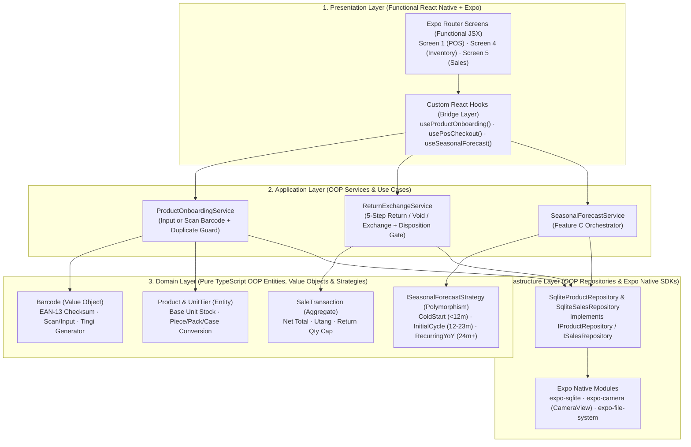

# React Native (Expo) & OOP Best Practices for Startup Tindahan Helper POS

> **Project**: Startup Tindahan Helper (*Juan's Store POS & Inventory System*)  
> **Research Engine**: AnySearch (`code.doc` for `expo`, `expo-sqlite`, `expo-camera`, and Clean Architecture / Domain-Driven Design OOP patterns in React Native & TypeScript)  
> **Companion Specification**: [POS_PROBLEMS_AND_SEASONAL_FORECAST.md](file:///c:/Developer/startupTindahanHelper/POS_PROBLEMS_AND_SEASONAL_FORECAST.md) · **UI Prototype**: [Gemini_Generated_Image_tx51cztx51cztx51.jpg](file:///c:/Developer/startupTindahanHelper/ui/Gemini_Generated_Image_tx51cztx51cztx51.jpg)

---

## 1. Executive Summary: How OOP and React Native (Expo) Fit Together

A common mistake in React Native development is either:
1. **Putting all POS business logic inside UI components and `useState` hooks** (which leads to 800-line screen files where barcode validation, *tingi* unit conversion, return/exchange math, and SQLite queries are tangled with JSX), **OR**
2. **Using legacy React class components (`class PosScreen extends React.Component`)** for UI, which fights modern Expo Router and React Hooks.

### The Gold-Standard Industry Pattern: **Functional UI + OOP Domain & Infrastructure (Clean Architecture)**

According to industry best practices researched via **AnySearch**:
- **UI Layer = Functional & Declarative**: Use **Function Components**, **Custom Hooks**, and **Immutable ViewModels/DTOs** for the 7 screens of Juan's Store (`app/(tabs)/...`). React relies on reference equality (`===`) to trigger re-renders, so UI state must always be plain immutable objects.
- **Business Logic & Data Layer = Object-Oriented Programming (OOP) in TypeScript**: Use **Classes, Interfaces, Value Objects, Domain Entities, Application Services, Strategy Pattern, and Repositories** inside `src/domain/`, `src/application/`, and `src/infrastructure/`.



---

## 2. Recommended Expo + OOP Project Directory Structure

Organize the Expo TypeScript project by separating the **Expo Router UI (`app/`)** from the **OOP Core (`src/`)**:

```text
startupTindahanHelper/
├── app/                                  # Presentation Routing (Expo Router v4+)
│   ├── _layout.tsx                       # Dependency Injection Provider & SQLite Init
│   ├── (tabs)/
│   │   ├── index.tsx                     # Screen 1: POS / Scan Product
│   │   ├── products.tsx                  # Screen 2: Product List
│   │   ├── checkout.tsx                  # Screen 3: Checkout / New Sale
│   │   ├── inventory.tsx                 # Screen 4: Inventory Management (+ Add Product)
│   │   ├── sales-history.tsx             # Screen 5: Sales History (Returns / Voids)
│   │   └── menu.tsx                      # Screen 6: Menu / Profile -> Sales Reports
│   └── modals/
│       ├── add-product.tsx               # Add Product Modal (Barcode Input OR Scan)
│       ├── return-exchange-wizard.tsx    # 5-Step Return / Exchange / Void Modal
│       ├── seasonal-forecast.tsx         # Feature C: Seasonal Product Forecast Screen
│       └── settings.tsx                  # Screen 7: Store Settings
├── src/
│   ├── domain/                           # PURE OOP (Zero React/Expo imports — 100% unit-testable)
│   │   ├── value-objects/
│   │   │   ├── Barcode.ts                # Encapsulates scanned or manually typed barcode rules
│   │   │   └── Money.ts                  # Safe PHP (₱) centavo arithmetic (avoids float bugs)
│   │   ├── entities/
│   │   │   ├── Product.ts                # Base unit stock, tingi/pack/case tiers, seasonal thresholds
│   │   │   ├── SaleTransaction.ts        # Line items, split tenders, void/return state machine
│   │   │   └── StockMovement.ts          # Base class + Sale, Restock, Return, Damage subclasses
│   │   ├── strategies/
│   │   │   ├── ISeasonalForecastStrategy.ts
│   │   │   ├── ColdStartForecastStrategy.ts       # < 12 months history
│   │   │   ├── InitialCycle12MonthStrategy.ts     # 12–23 months history
│   │   │   └── Recurring24MonthYoYStrategy.ts     # 24+ months verified recurring patterns
│   │   └── repositories/                 # Abstract Interfaces (Dependency Inversion)
│   │       ├── IProductRepository.ts
│   │       ├── ISalesRepository.ts
│   │       └── IStockLedgerRepository.ts
│   ├── application/                      # OOP Use-Case Services
│   │   ├── ProductOnboardingService.ts   # Handles Add Product (Input or Scan + Duplicate Check)
│   │   ├── PosCheckoutService.ts         # Handles Cart, Utang Ledger, Split Tender
│   │   ├── ReturnExchangeService.ts      # Handles Void vs Refund + Sellable/Damaged Gate
│   │   └── SeasonalForecastService.ts    # Computes Monthly Net Uncensored Demand & SI(i,m)
│   ├── infrastructure/                   # Concrete Expo SDK Implementations
│   │   ├── database/
│   │   │   ├── sqliteClient.ts           # expo-sqlite connection & migrations
│   │   │   ├── SqliteProductRepository.ts
│   │   │   ├── SqliteSalesRepository.ts
│   │   │   └── SqliteStockLedgerRepository.ts
│   │   └── container.ts                  # Singleton DI Container wiring Repos -> Services
│   └── presentation/                     # Custom Hooks & Reusable UI Components
│       ├── hooks/
│       │   ├── useBarcodeInputOrScan.ts  # Shared camera scan + manual input hook
│       │   ├── useInventory.ts
│       │   └── useSeasonalForecast.ts
│       └── components/
│           ├── BarcodeInputField.tsx     # Input box with inline [Scan] icon button
│           └── SeasonalBadge.tsx
└── package.json
```

---

## 3. Applying the 4 Pillars of OOP to Juan's Store POS (TypeScript Implementation)

Below are concrete TypeScript OOP implementations that directly solve the problems identified in [POS_PROBLEMS_AND_SEASONAL_FORECAST.md](file:///c:/Developer/startupTindahanHelper/POS_PROBLEMS_AND_SEASONAL_FORECAST.md).

---

### Pillar 1: Encapsulation — `Barcode` Value Object (Manual Input OR Camera Scan)

> **Requirement**: *"When adding a product, the barcode must be input or scan."*

Instead of passing raw `string` barcodes around the app (which allows spaces, invalid check digits, or empty strings to corrupt the database), encapsulate all barcode validation and formatting inside an immutable `Barcode` **Value Object** class:

```typescript
// src/domain/value-objects/Barcode.ts

export type BarcodeSource = 'CAMERA_SCAN' | 'MANUAL_INPUT' | 'GENERATED_TINGI';

export class Barcode {
  private readonly _code: string;
  private readonly _source: BarcodeSource;

  private constructor(code: string, source: BarcodeSource) {
    this._code = code;
    this._source = source;
  }

  /**
   * Factory Method 1: Create from Camera Barcode Scanner (Screen 1 or Screen 4 '+' Add Product)
   */
  public static fromCameraScan(rawScannedData: string): Barcode {
    const cleaned = rawScannedData.trim();
    if (!cleaned) {
      throw new Error('Scanned barcode cannot be empty.');
    }
    return new Barcode(cleaned, 'CAMERA_SCAN');
  }

  /**
   * Factory Method 2: Create from Manual Keypad Input (When wrapper is crumpled/wet or typed by owner)
   * Validates numeric EAN-8 / UPC-A / EAN-13 check digits or allows explicit custom store shortcodes.
   */
  public static fromManualInput(rawInput: string, allowCustomShortcode = true): Barcode {
    const cleaned = rawInput.trim().toUpperCase();
    if (!cleaned) {
      throw new Error('Please input a barcode or scan the product.');
    }

    // If purely digits (8, 12, or 13 digits), verify standard retail GS1/EAN checksum to catch typing typos
    if (/^\d{8}$|^\d{12,13}$/.test(cleaned)) {
      if (!Barcode.isValidGs1Checksum(cleaned)) {
        throw new Error(
          `Barcode "${cleaned}" has an invalid check digit. Please re-check the numbers printed under the barcode or use Camera Scan.`
        );
      }
      return new Barcode(cleaned, 'MANUAL_INPUT');
    }

    if (allowCustomShortcode && /^[A-Z0-9#-]{2,20}$/.test(cleaned)) {
      return new Barcode(cleaned, 'MANUAL_INPUT');
    }

    throw new Error('Barcode must be an 8/12/13-digit retail barcode or a valid store code (e.g., #01, TINGI-01).');
  }

  /**
   * Factory Method 3: Auto-generate for unbarcoded Tingi / Repacked items (e.g. Ice, Repacked Sugar, Single Pen)
   */
  public static generateStoreCode(categoryPrefix: string, sequenceNumber: number): Barcode {
    const prefix = categoryPrefix.replace(/[^A-Z]/gi, '').slice(0, 3).toUpperCase() || 'SKU';
    const padded = String(sequenceNumber).padStart(4, '0');
    return new Barcode(`${prefix}-${padded}`, 'GENERATED_TINGI');
  }

  /**
   * Standard GS1 Modulo-10 Check-Digit Algorithm (EAN-13 / EAN-8 / UPC-A)
   */
  public static isValidGs1Checksum(digits: string): boolean {
    const nums = digits.split('').map(Number);
    const checkDigit = nums.pop()!;
    const sum = nums
      .reverse()
      .reduce((acc, digit, idx) => acc + digit * (idx % 2 === 0 ? 3 : 1), 0);
    const calculatedCheck = (10 - (sum % 10)) % 10;
    return checkDigit === calculatedCheck;
  }

  public get value(): string {
    return this._code;
  }

  public get source(): BarcodeSource {
    return this._source;
  }

  public equals(other: Barcode): boolean {
    return this._code === other._code;
  }
}
```

---

### Pillar 2: Abstraction & Single Source of Truth — `Product` Entity (*Tingi* Multi-Unit & Seasonal Threshold)

This `Product` domain entity solves **Problem 3** (the *Piattos BBQ* ₱16.00 vs. ₱12.00 price discrepancy between Screen 1/Screen 3 and Screen 2) and **Problem C6** (dynamic seasonal low-stock thresholds):

```typescript
// src/domain/entities/Product.ts
import { Barcode } from '../value-objects/Barcode';

export interface SellingUnitTier {
  unitName: 'piece' | 'bundle' | 'pack' | 'case';
  baseUnitMultiplier: number; // e.g., 1 for piece, 2 for 2-pc bundle, 24 for case
  unitPricePhp: number;       // e.g., ₱16.00 for 1 pc, ₱24.00 for 2-pc bundle (₱12/pc)
  unitBarcode?: Barcode;      // Optional separate barcode for outer pack/case
}

export class Product {
  constructor(
    public readonly id: string,
    private _name: string,
    private _categoryId: string,
    private _barcode: Barcode,
    private _baseStockCount: number,
    private _ordinaryLowStockThreshold: number,
    private _unitCostPhp: number,
    private _sellingTiers: SellingUnitTier[]
  ) {
    if (_sellingTiers.length === 0) {
      throw new Error('Product must have at least one selling unit tier (e.g., piece).');
    }
  }

  public get barcode(): Barcode {
    return this._barcode;
  }

  public get baseStockCount(): number {
    return this._baseStockCount;
  }

  /**
   * Resolves unit price & base units deducted for any quantity (handles single piece vs bundle promo)
   */
  public calculateLineTotalPhp(quantityInPieces: number): number {
    const bundleTier = this._sellingTiers.find(
      (t) => t.unitName === 'bundle' && quantityInPieces >= t.baseUnitMultiplier
    );
    const pieceTier = this._sellingTiers.find((t) => t.unitName === 'piece') ?? this._sellingTiers[0];

    if (bundleTier && quantityInPieces % bundleTier.baseUnitMultiplier === 0) {
      const bundles = quantityInPieces / bundleTier.baseUnitMultiplier;
      return bundles * bundleTier.unitPricePhp;
    }
    return quantityInPieces * pieceTier.unitPricePhp;
  }

  /**
   * Dynamic Low-Stock Status for Screen 4 (Inventory Management):
   * Scales the low-stock threshold upward when entering a seasonal peak month (Feature C).
   */
  public getStockStatus(activeSeasonalIndex = 1.0): 'IN_STOCK' | 'LOW_STOCK' | 'OUT_OF_STOCK' {
    if (this._baseStockCount <= 0) return 'OUT_OF_STOCK';
    const effectiveThreshold = Math.ceil(
      this._ordinaryLowStockThreshold * Math.max(1.0, activeSeasonalIndex)
    );
    return this._baseStockCount <= effectiveThreshold ? 'LOW_STOCK' : 'IN_STOCK';
  }

  /**
   * Immutable-style state transition for React compatibility:
   * Returns a plain DTO snapshot for React hooks/Zustand stores.
   */
  public toDTO(activeSeasonalIndex = 1.0) {
    return {
      id: this.id,
      name: this._name,
      categoryId: this._categoryId,
      barcode: this._barcode.value,
      barcodeSource: this._barcode.source,
      stockCount: this._baseStockCount,
      stockStatus: this.getStockStatus(activeSeasonalIndex),
      defaultPricePhp: this._sellingTiers[0].unitPricePhp,
    };
  }
}
```

---

### Pillar 3: Polymorphism & Strategy Pattern — `Feature C: Seasonal Product Forecast`

> **Requirement**:  
> **C. Seasonal Product Forecast**  
> *Compare the same month across previous years and use the store's actual sales history. Around 12 months provides an initial seasonal cycle; 24 months or more gives better evidence of recurring patterns.*

Using the **OOP Strategy Pattern**, we define a common `ISeasonalForecastStrategy` interface and swap the concrete algorithm automatically based on whether the store has `< 12 months`, `12–23 months`, or `24+ months` of sales history:

```typescript
// src/domain/strategies/ISeasonalForecastStrategy.ts

export interface MonthlySalesRecord {
  year: number;
  month: number;               // 1 (Jan) .. 12 (Dec)
  grossUnitsSold: number;
  voidedUnits: number;
  returnedChangedMindUnits: number;
  outOfStockDays: number;
  totalDaysInMonth: number;
}

export interface SeasonalForecastResult {
  targetMonth: number;
  seasonalIndex: number;       // SI(i,m): e.g., 4.00x for Intermediate Pad Paper in July
  peakVsOrdinaryMultiplier: number;
  forecastedUnits: number;
  recommendedRestockQty: number;
  confidenceTier: 'PROVISIONAL_UNDER_12M' | 'INITIAL_CYCLE_12_23M' | 'VERIFIED_RECURRING_24M_PLUS';
  explanation: string;
}

export interface ISeasonalForecastStrategy {
  forecast(
    history: MonthlySalesRecord[],
    targetMonth: number,
    currentStock: number,
    categoryPriorIndex: number
  ): SeasonalForecastResult;
}
```

```typescript
// src/domain/strategies/SeasonalForecastEngine.ts
import {
  ISeasonalForecastStrategy,
  MonthlySalesRecord,
  SeasonalForecastResult,
} from './ISeasonalForecastStrategy';

/**
 * Abstract Base Class (Inheritance + Template Method Pattern):
 * Provides shared math for Net Uncensored Demand D(i,y,m) so all strategies
 * properly subtract voids/returns and adjust for stockout-censored days.
 */
export abstract class BaseSeasonalStrategy implements ISeasonalForecastStrategy {
  protected computeUncensoredNetDemand(record: MonthlySalesRecord): number {
    const netSold = Math.max(
      0,
      record.grossUnitsSold - record.voidedUnits - record.returnedChangedMindUnits
    );
    const inStockDays = Math.max(1, record.totalDaysInMonth - record.outOfStockDays);
    // Cap stockout imputation factor at 2.0x to prevent extreme extrapolation
    const availabilityFactor = Math.min(2.0, record.totalDaysInMonth / inStockDays);
    return netSold * availabilityFactor;
  }

  public abstract forecast(
    history: MonthlySalesRecord[],
    targetMonth: number,
    currentStock: number,
    categoryPriorIndex: number
  ): SeasonalForecastResult;
}

/**
 * Concrete Strategy 1: 24+ Months History (Multi-Year Recurring YoY Comparison)
 */
export class Recurring24MonthYoYStrategy extends BaseSeasonalStrategy {
  public forecast(
    history: MonthlySalesRecord[],
    targetMonth: number,
    currentStock: number
  ): SeasonalForecastResult {
    const uncensored = history.map((r) => ({
      ...r,
      demand: this.computeUncensoredNetDemand(r),
    }));

    // Group by year to compute each year's Seasonal Index for targetMonth
    const years = Array.from(new Set(uncensored.map((r) => r.year))).sort();
    const monthlyFactors: number[] = [];

    for (const yr of years) {
      const yearRecords = uncensored.filter((r) => r.year === yr);
      if (yearRecords.length < 6) continue;
      const yearAvg =
        yearRecords.reduce((sum, r) => sum + r.demand, 0) / yearRecords.length;
      const targetRecord = yearRecords.find((r) => r.month === targetMonth);
      if (targetRecord && yearAvg > 0) {
        monthlyFactors.push(targetRecord.demand / yearAvg);
      }
    }

    const seasonalIndex =
      monthlyFactors.length > 0
        ? monthlyFactors.reduce((a, b) => a + b, 0) / monthlyFactors.length
        : 1.0;

    // Trailing 12-Month (T12M) Baseline
    const recent12 = uncensored.slice(-12);
    const t12mBaseline =
      recent12.reduce((sum, r) => sum + r.demand, 0) / Math.max(1, recent12.length);

    // Ordinary (non-peak) average for human-readable comparison (e.g. School Supplies vs Ordinary Months)
    const ordinaryMonths = uncensored.filter((r) => r.month !== targetMonth);
    const ordinaryAvg =
      ordinaryMonths.reduce((sum, r) => sum + r.demand, 0) /
      Math.max(1, ordinaryMonths.length);

    const forecastedUnits = Math.ceil(t12mBaseline * seasonalIndex);
    const safetyStock = Math.ceil(forecastedUnits * 0.15);
    const recommendedRestockQty = Math.max(0, forecastedUnits + safetyStock - currentStock);

    return {
      targetMonth,
      seasonalIndex: Number(seasonalIndex.toFixed(2)),
      peakVsOrdinaryMultiplier: Number(
        (forecastedUnits / Math.max(1, ordinaryAvg)).toFixed(1)
      ),
      forecastedUnits,
      recommendedRestockQty,
      confidenceTier: 'VERIFIED_RECURRING_24M_PLUS',
      explanation: `Verified across ${years.length} annual cycles (${history.length} months of store history).`,
    };
  }
}

/**
 * Concrete Strategy 2: 12–23 Months History (Initial Seasonal Cycle)
 */
export class InitialCycle12MonthStrategy extends BaseSeasonalStrategy {
  public forecast(
    history: MonthlySalesRecord[],
    targetMonth: number,
    currentStock: number,
    categoryPriorIndex: number
  ): SeasonalForecastResult {
    const uncensored = history.map((r) => ({
      ...r,
      demand: this.computeUncensoredNetDemand(r),
    }));
    const t12mBaseline =
      uncensored.reduce((sum, r) => sum + r.demand, 0) / Math.max(1, uncensored.length);
    const sameMonthLastYear = uncensored.find((r) => r.month === targetMonth);
    const rawStoreIndex =
      sameMonthLastYear && t12mBaseline > 0
        ? sameMonthLastYear.demand / t12mBaseline
        : categoryPriorIndex;

    // 70% Store Year-1 Index + 30% Category Prior to dampen single-year noise
    const blendedIndex = 0.7 * rawStoreIndex + 0.3 * categoryPriorIndex;
    const forecastedUnits = Math.ceil(t12mBaseline * blendedIndex);
    const recommendedRestockQty = Math.max(
      0,
      Math.ceil(forecastedUnits * 1.15) - currentStock
    );

    return {
      targetMonth,
      seasonalIndex: Number(blendedIndex.toFixed(2)),
      peakVsOrdinaryMultiplier: Number(blendedIndex.toFixed(1)),
      forecastedUnits,
      recommendedRestockQty,
      confidenceTier: 'INITIAL_CYCLE_12_23M',
      explanation: 'Based on 1 full annual seasonal cycle (12–23 months) with outlier smoothing.',
    };
  }
}
```

---

### Pillar 4: Dependency Inversion & Repository Pattern (`expo-sqlite` + Add Product Service)

In Clean Architecture, `ProductOnboardingService` depends on an abstract `IProductRepository` interface rather than calling `expo-sqlite` directly. This makes it trivial to unit-test with an in-memory mock repository and swap or upgrade storage engines later.

```typescript
// src/domain/repositories/IProductRepository.ts
import { Product } from '../entities/Product';
import { Barcode } from '../value-objects/Barcode';

export interface IProductRepository {
  findByBarcode(barcode: Barcode): Promise<Product | null>;
  save(product: Product): Promise<void>;
  getNextTingiSequence(): Promise<number>;
}
```

```typescript
// src/application/ProductOnboardingService.ts
import { IProductRepository } from '../domain/repositories/IProductRepository';
import { Barcode } from '../domain/value-objects/Barcode';
import { Product } from '../domain/entities/Product';

export interface AddProductCommand {
  name: string;
  categoryId: string;
  barcodeInputMode: 'SCAN' | 'MANUAL' | 'GENERATE_TINGI';
  rawBarcodeValue?: string;
  initialStock: number;
  lowStockThreshold: number;
  unitCostPhp: number;
  unitPricePhp: number;
}

export class ProductOnboardingService {
  constructor(private readonly productRepo: IProductRepository) {}

  /**
   * Enforces that adding a product ALWAYS registers a valid barcode via Scan, Manual Input, or Generator,
   * and blocks duplicate barcode creation.
   */
  public async registerNewProduct(cmd: AddProductCommand) {
    // 1. Construct validated Barcode Value Object based on entry mode
    let barcode: Barcode;
    if (cmd.barcodeInputMode === 'SCAN') {
      barcode = Barcode.fromCameraScan(cmd.rawBarcodeValue ?? '');
    } else if (cmd.barcodeInputMode === 'MANUAL') {
      barcode = Barcode.fromManualInput(cmd.rawBarcodeValue ?? '');
    } else {
      const seq = await this.productRepo.getNextTingiSequence();
      barcode = Barcode.generateStoreCode(cmd.categoryId, seq);
    }

    // 2. Instant Duplicate Barcode Guard
    const existing = await this.productRepo.findByBarcode(barcode);
    if (existing) {
      return {
        status: 'DUPLICATE_BARCODE_FOUND' as const,
        existingProduct: existing.toDTO(),
        message: `Barcode ${barcode.value} is already registered to "${existing.toDTO().name}". Would you like to Add Stock (+ Restock) instead?`,
      };
    }

    // 3. Create Domain Entity & Persist
    const product = new Product(
      `prod_${Date.now()}`,
      cmd.name.trim(),
      cmd.categoryId,
      barcode,
      cmd.initialStock,
      cmd.lowStockThreshold,
      cmd.unitCostPhp,
      [{ unitName: 'piece', baseUnitMultiplier: 1, unitPricePhp: cmd.unitPricePhp }]
    );

    await this.productRepo.save(product);

    return {
      status: 'CREATED' as const,
      product: product.toDTO(),
    };
  }
}
```

---

## 4. Expo Hardware & UI Integration Best Practices (`expo-camera` & `expo-sqlite`)

### 1. Reusable Dual-Mode Barcode Component (`Manual Input` OR `Camera Scan`)
In **Expo SDK 51+**, use `CameraView` from `expo-camera` and **disable `onBarcodeScanned` immediately after the first scan** (`onBarcodeScanned={isScanning ? handleScan : undefined}`) so the camera doesn't fire 30 callbacks per second while the modal is closing:

```tsx
// src/presentation/components/BarcodeInputField.tsx
import React, { useState, useCallback } from 'react';
import { View, TextInput, Pressable, Text, StyleSheet } from 'react-native';
import { CameraView, useCameraPermissions, BarcodeScanningResult } from 'expo-camera';

interface Props {
  value: string;
  onChangeBarcode: (code: string, mode: 'SCAN' | 'MANUAL') => void;
  onDuplicateCheck?: (code: string) => void;
}

export const BarcodeInputField: React.FC<Props> = ({
  value,
  onChangeBarcode,
  onDuplicateCheck,
}) => {
  const [permission, requestPermission] = useCameraPermissions();
  const [scannerOpen, setScannerOpen] = useState(false);
  const [scanLocked, setScanLocked] = useState(false);

  const handleOpenScanner = async () => {
    if (!permission?.granted) {
      const res = await requestPermission();
      if (!res.granted) return;
    }
    setScanLocked(false);
    setScannerOpen(true);
  };

  const handleBarcodeScanned = useCallback(
    (result: BarcodeScanningResult) => {
      if (scanLocked) return;
      setScanLocked(true); // Lock immediately after first frame hit
      setScannerOpen(false);
      onChangeBarcode(result.data, 'SCAN');
      onDuplicateCheck?.(result.data);
    },
    [scanLocked, onChangeBarcode, onDuplicateCheck]
  );

  return (
    <View style={styles.container}>
      <Text style={styles.label}>Product Barcode (Type Digits or Scan) *</Text>
      <View style={styles.inputRow}>
        <TextInput
          style={styles.input}
          value={value}
          placeholder="e.g. 6800056520709"
          keyboardType="default"
          onChangeText={(text) => onChangeBarcode(text, 'MANUAL')}
          onBlur={() => value && onDuplicateCheck?.(value)}
        />
        <Pressable style={styles.scanButton} onPress={handleOpenScanner}>
          <Text style={styles.scanButtonText}>Scan</Text>
        </Pressable>
      </View>

      {scannerOpen && (
        <View style={styles.cameraWrapper}>
          <CameraView
            style={styles.camera}
            facing="back"
            barcodeScannerSettings={{
              barcodeTypes: ['ean13', 'ean8', 'upc_a', 'upc_e', 'code128', 'qr'],
            }}
            // Critical Expo Best Practice: pass undefined once locked to stop duplicate callbacks
            onBarcodeScanned={scanLocked ? undefined : handleBarcodeScanned}
          />
        </View>
      )}
    </View>
  );
};

const styles = StyleSheet.create({
  container: { marginVertical: 8 },
  label: { fontWeight: '600', marginBottom: 6, color: '#1F2937' },
  inputRow: { flexDirection: 'row', alignItems: 'center', gap: 8 },
  input: {
    flex: 1,
    borderWidth: 1,
    borderColor: '#D1D5DB',
    borderRadius: 8,
    paddingHorizontal: 12,
    paddingVertical: 10,
    fontSize: 16,
  },
  scanButton: {
    backgroundColor: '#0F6E43',
    paddingHorizontal: 16,
    paddingVertical: 11,
    borderRadius: 8,
  },
  scanButtonText: { color: '#FFFFFF', fontWeight: '700' },
  cameraWrapper: { height: 220, marginTop: 10, borderRadius: 12, overflow: 'hidden' },
  camera: { flex: 1 },
});
```

---

### 2. Golden Rules for Using OOP in React Native (Expo)

| Rule | Anti-Pattern (Do Not Do This) | Best Practice (Do This Instead) |
| :--- | :--- | :--- |
| **Rule 1: Never Put Mutable Class Instances Directly Inside `useState` / Zustand** | `const [product, setProduct] = useState(new Product(...)); product.deductStock(1); setProduct(product);` *(React won't re-render because the object reference didn't change!)* | Keep OOP entities inside the **Service/Domain layer**, and return plain immutable DTO snapshots (`product.toDTO()`) to React Hooks and UI components. |
| **Rule 2: Wrap Multi-Table POS Writes in `db.withTransactionAsync`** | Running separate `INSERT INTO sales` and `UPDATE products SET stock = ...` queries without a transaction *(if the app crashes mid-way, sales and stock go out of sync)*. | Inside `SqliteSalesRepository`, always wrap receipt creation, line-item insertion, and stock movement ledger entries inside `await db.withTransactionAsync(async () => { ... })`. |
| **Rule 3: Debounce / Gate `CameraView.onBarcodeScanned`** | Leaving `onBarcodeScanned={handleScan}` active continuously while adding an item to the cart *(adds 15 Piattos in 0.5 seconds)*. | Set `onBarcodeScanned={isLocked ? undefined : handleScan}` and apply a `1200ms` cooldown or audio/haptic confirmation between scans. |
| **Rule 4: Use Integer Centavos for PHP Currency Math** | `0.1 + 0.2 === 0.30000000000000004` in IEEE-754 floating point, causing `₱0.01` rounding discrepancies on discounts and split payments. | Encapsulate currency in a `Money` Value Object storing integer centavos (`₱16.00` = `1600` centavos) and format to `₱16.00` only at the UI display layer. |
| **Rule 5: Virtualize Product & Inventory Lists with `@shopify/flash-list`** | Rendering 1,500 *sari-sari* store SKUs with `ScrollView` or unoptimized `FlatList` on budget Android phones. | Use `<FlashList estimatedItemSize={72} />` for **Screen 2 (`Product List`)**, **Screen 4 (`Inventory`)**, and **Screen 5 (`Sales History`)**. |
